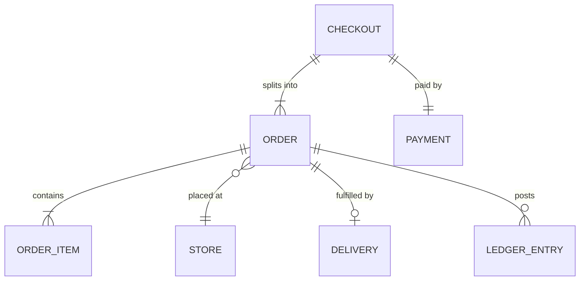

# Data model

[Docs](../README.md) / Architecture / Data model

The database has eight table groups. Each backend module owns its own tables and other
modules reach them only through that module. This is the initial sketch; column-level
schemas will be added per group as they are built.

## Table groups

| Group | Tables |
|---|---|
| People | `users`, `auth_identities`, `customer_profiles`, `addresses`, `vendor_members`, `delivery_partners` |
| Vendors and catalog | `vendors`, `vendor_documents`, `stores`, `store_hours`, `cities`, `delivery_zones`, `store_zones`, `categories`, `products`, `variants`, `inventory` |
| Storefront | `featured_sections`, `featured_section_items`, `platform_settings` |
| Monetization | `category_commissions`, `plans`, `plan_features`, `vendor_subscriptions`, `subscription_invoices` |
| Ordering | `carts`, `cart_items`, `checkouts`, `orders`, `order_items`, `payments`, `refunds`, `coupons` |
| Delivery | `deliveries`, `delivery_offers`, `delivery_events` |
| Feedback | `store_reviews`, `item_reviews`, `rider_reviews` |
| Money and audit | `ledger_entries`, `vendor_wallets`, `payouts`, `audit_log`, `outbox_events` |

## Checkout and orders

A `checkout` is what the customer pays for. It holds one `order` per store, so each store
accepts, prepares and is paid for its own part.

Flow: [Multi-store checkout](../flows/system/multi-store-checkout.md).

## Rules that protect money and history

- **Money is stored as whole paise** with a currency code, never as a decimal fraction.
- **The commission rate is copied onto each order line** at purchase.
- **The ledger is append-only.** Balances are derived from entries, and a correction is a
  new entry.
- **An order's state change and its event are written in one transaction**, so
  notifications, search and analytics never miss a change or fire twice.

Related: [Monetization](../product/monetization.md), [Order lifecycle](../flows/system/order-lifecycle.md).
