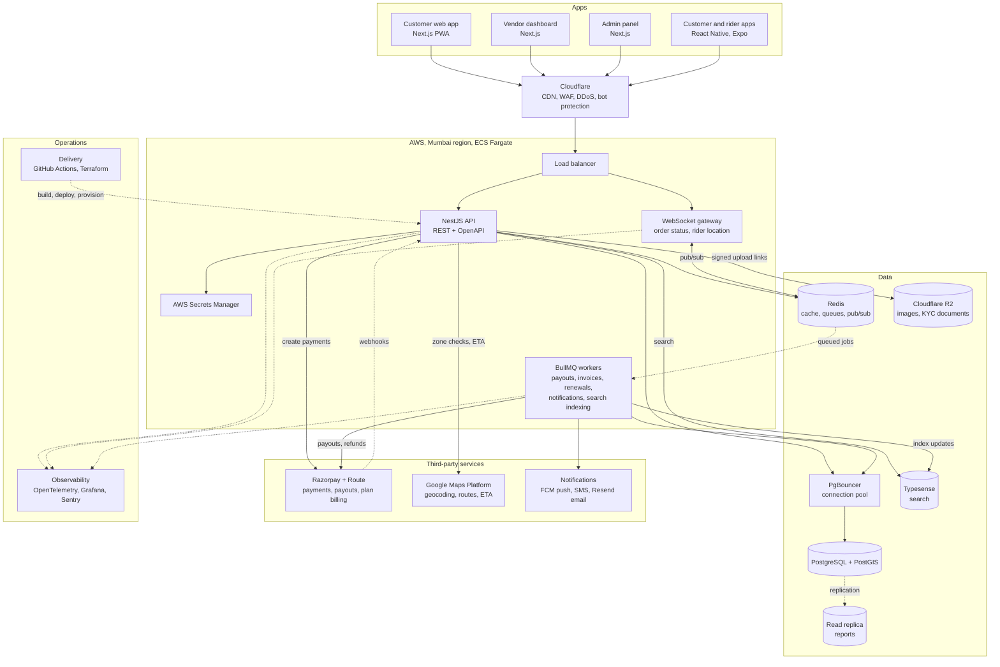

# Technology integration

[Docs](../README.md) / Architecture / Technology integration

How every technology in the [tech stack](tech-stack.md) connects. Solid arrows are requests
and data; dotted arrows are background, webhook, deployment or telemetry traffic.

The apps also load two third-party SDKs directly in the browser or phone: the Razorpay
checkout sheet for payment, and Google Maps for address search and the live tracking map.
Product images in R2 are served to the apps through Cloudflare's CDN.

Related: [System overview](overview.md), [Scaling and traffic](scaling.md), [Security](security.md).
