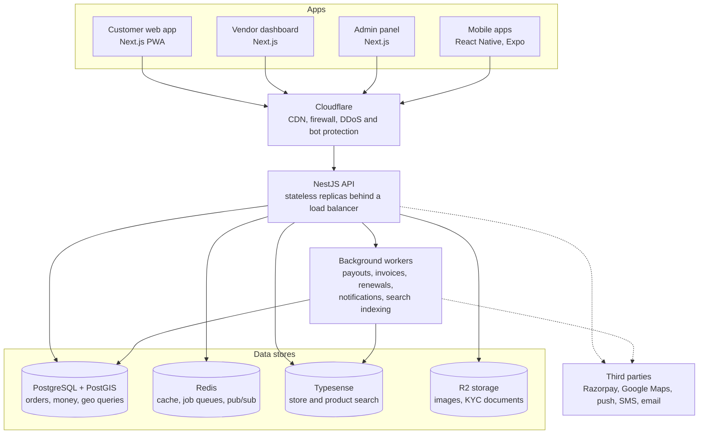

# System overview

[Docs](../README.md) / Architecture / System overview

Every app reaches one API through Cloudflare. Slow work is handed to background workers,
and third-party services are called only from the backend.

## Backend modules

The API is a modular monolith: one deployable, split into modules with enforced boundaries.

`auth` · `users` · `vendors` · `catalog` · `inventory` · `geo` · `storefront` · `cart` ·
`checkout` · `orders` · `payments` · `commissions` · `subscriptions` · `ledger` · `payouts` ·
`dispatch` · `notifications` · `reviews` · `promotions` · `search-indexer` · `admin` · `analytics`

A module reaches another module's data only through that module's exported service or a
domain event, never by reading its tables. This is what keeps a later split into services cheap.

## Related

- [Tech stack](tech-stack.md)
- [Scaling and traffic](scaling.md)
- [Data model](data-model.md)
- [Security and compliance](security.md)
