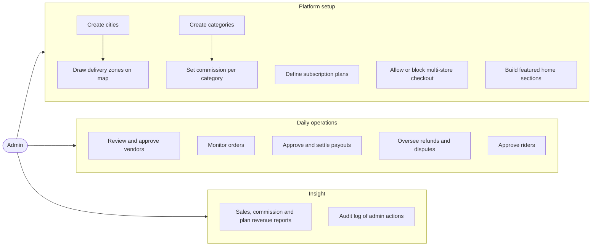

# Admin flows

[Docs](../../README.md) / [Flows](../README.md) / Admin

The admin uses the admin panel. Work falls into three groups: setting the platform up,
running it day to day, and reading reports.

## Overview

## Detailed flows

| # | Flow | Group | Screens covered |
|---|---|---|---|
| 1 | [Delivery zones](zones.md) | Setup | Cities, zone map editor, zone settings |
| 2 | [Categories and commissions](categories-and-commissions.md) | Setup | Category tree, commission rates, store overrides |
| 3 | [Subscription plans](plans.md) | Setup | Plan list, plan editor, subscribers |
| 4 | [Storefront](storefront.md) | Setup | Featured sections, banners, multi-store checkout switch, platform settings |
| 5 | [Vendor approval](vendor-approval.md) | Daily | Application queue, document review, suspend |
| 6 | [Orders and refunds](orders-and-refunds.md) | Daily | Live orders, order detail, interventions, refund approvals |
| 7 | [Payouts](payouts.md) | Daily | Payout batches, holds, failures |
| 8 | [Riders, users and reports](riders-users-reports.md) | Daily and insight | Rider approval, customers, staff roles, reports, audit log |

Every action an admin takes is written to the audit log with who, what, when and the
before and after values.
