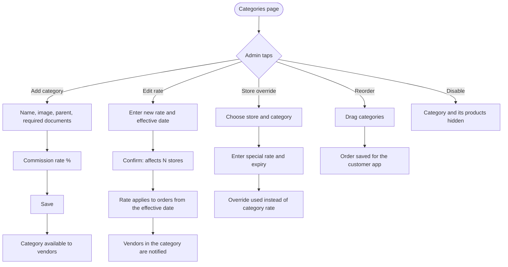
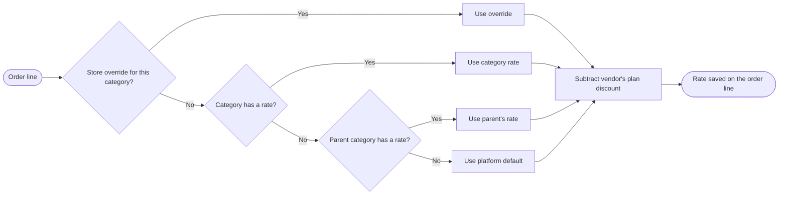

# Categories and commissions

[Docs](../../README.md) / [Flows](../README.md) / [Admin](README.md) / Categories and commissions

Categories organise the catalog and carry the commission rate the platform earns.

## Flow

## How the rate for an order line is chosen

## Actions

| Screen | Element | Admin does | What happens | Leads to |
|---|---|---|---|---|
| Categories | Category tree | Expands rows | Shows sub-categories with rate, product count and status | Stays |
| Categories | **Add category** | Taps | Form opens | Category form |
| Category form | Name, image, parent | Fills | A category with no parent is top-level (Food, Grocery) | Stays |
| Category form | Required documents | Ticks (food licence, drug licence) | Vendors choosing this category must upload them at onboarding | Stays |
| Category form | Product approval toggle | Switches on | New products in this category wait for admin approval | Stays |
| Category form | Commission rate | Enters a percentage | Left empty, the category inherits its parent's rate | Stays |
| Category form | **Save** | Taps | Category is created and appears in vendor and customer apps | Categories |
| Categories | Rate cell | Clicks, enters a new rate and date | A confirmation shows how many stores are affected | Confirm dialog |
| Confirm dialog | **Confirm** | Taps | The new rate is stored with its start date; the old rate stays on record | Categories |
| Categories | **Store overrides** tab | Opens | Lists special rates by store | Overrides list |
| Overrides | **Add override** | Picks store, category, rate, optional expiry | That store's orders in that category use the override | Overrides list |
| Categories | Drag handle | Drags a row | Display order updates in the customer app | Stays |
| Categories | **Disable** | Taps, confirms | Category and its products are hidden from customers; nothing is deleted | Categories |
| Settings | Platform default rate | Enters | Used when no category in the chain has a rate | Stays |

## Rules and edge cases

- **Past orders never change:** the rate is copied onto each order line at purchase.
- **Rate history:** every change is kept with its date and the admin who made it.
- **Rate bounds:** 0% to 50%; a change of more than 5 points asks for a second confirmation.
- **Deleting:** a category with products or order history can only be disabled.
- **Moving a category** under a different parent keeps its own rate; if it had none it now inherits the new parent's.

## Related

- [Monetization](../../product/monetization.md)
- [Vendor: products](../vendor/products.md)
