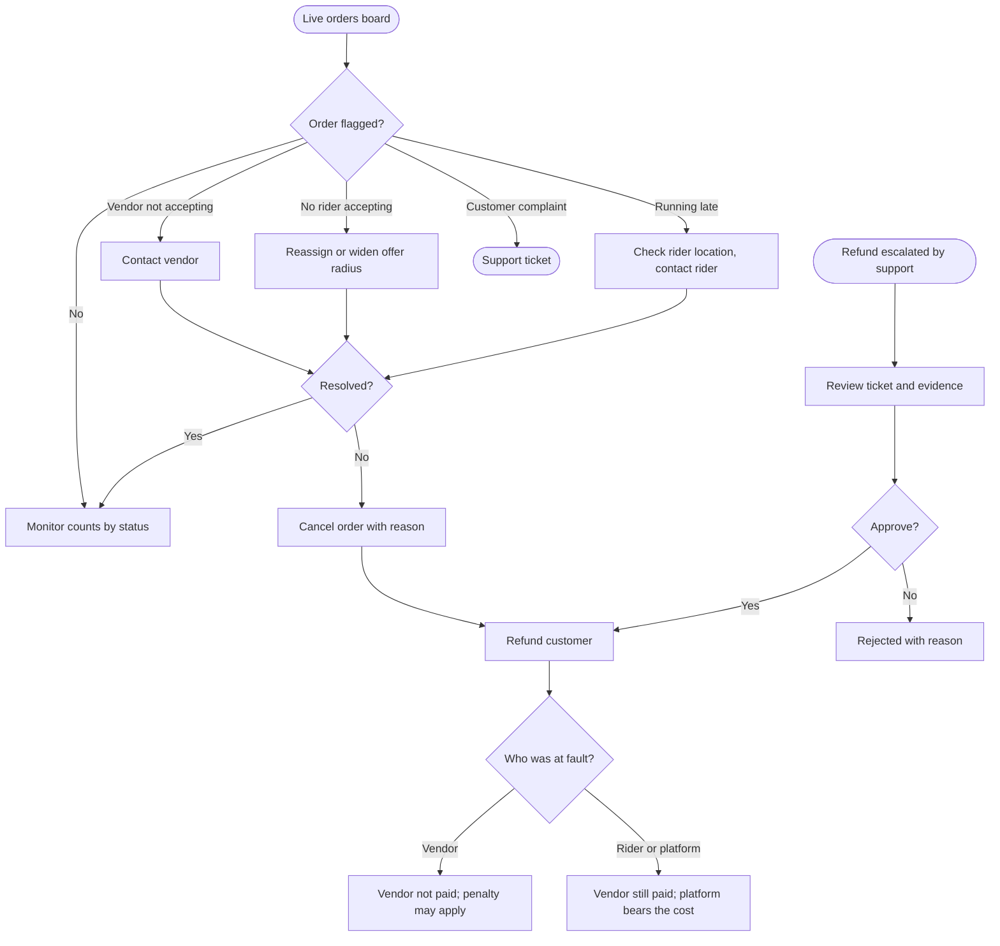

# Orders and refunds

[Docs](../../README.md) / [Flows](../README.md) / [Admin](README.md) / Orders and refunds

Watching live orders, stepping in when one is stuck, and approving refunds above the
support agent's limit.

## Flow

## Actions

| Screen | Element | Admin does | What happens | Leads to |
|---|---|---|---|---|
| Live board | Status columns | Views | Counts and cards update in real time | Stays |
| Live board | Filters: city, zone, store, status | Selects | Board narrows | Stays |
| Live board | Flagged card (red) | Clicks | Opens the order with the reason it was flagged | Order detail |
| Order detail | Timeline | Views | Every status change with time and who made it | Stays |
| Order detail | **Contact vendor / rider / customer** | Clicks | Shows the phone number and logs that it was viewed | Stays |
| Order detail | **Reassign rider** | Clicks | The current rider is released and the job is re-offered | Order detail |
| Order detail | **Change status** | Picks a status + reason | Forces the order forward or back when an app failed to update; only valid transitions are offered | Order detail |
| Order detail | **Cancel order** + reason + fault | Clicks, selects | Order is cancelled, the customer refunded, and the cost assigned to vendor or platform | Order detail |
| Order detail | **Refund** | Enters full or partial amount | Refund is sent to the gateway and reversing ledger entries are posted | Order detail |
| Refund approvals | Escalated ticket | Clicks | Shows the customer's claim, photos, the agent's note and the order | Ticket detail |
| Ticket detail | **Approve** / **Reject** | Clicks with a note | Approve triggers the refund; reject notifies the customer with the reason | Refund approvals |
| Orders | Search by order ID, phone, store | Types | Finds any order, live or past | Order detail |

## What flags an order

| Flag | Raised when |
|---|---|
| Not accepted | Vendor has not responded and 60% of the accept timer has passed |
| No rider | No rider has accepted within 5 minutes of the order being ready |
| Late | Estimated delivery time is exceeded by 15 minutes |
| Stuck | No status change for 30 minutes on an active order |
| Payment mismatch | Gateway amount differs from the checkout total |

## Rules and edge cases

- **Forced status changes** require a reason and are audited.
- **Refund above the original payment** is not possible; goodwill credit is issued as a coupon instead.
- **Cancelling after pickup:** the rider is paid for the trip; support decides what happens to the items.
- **Fault assignment** drives the ledger: vendor fault reverses the vendor's earning; platform fault does not.

## Related

- [Support: refunds and disputes](../support/refunds-and-disputes.md)
- [System: order lifecycle](../system/order-lifecycle.md)
