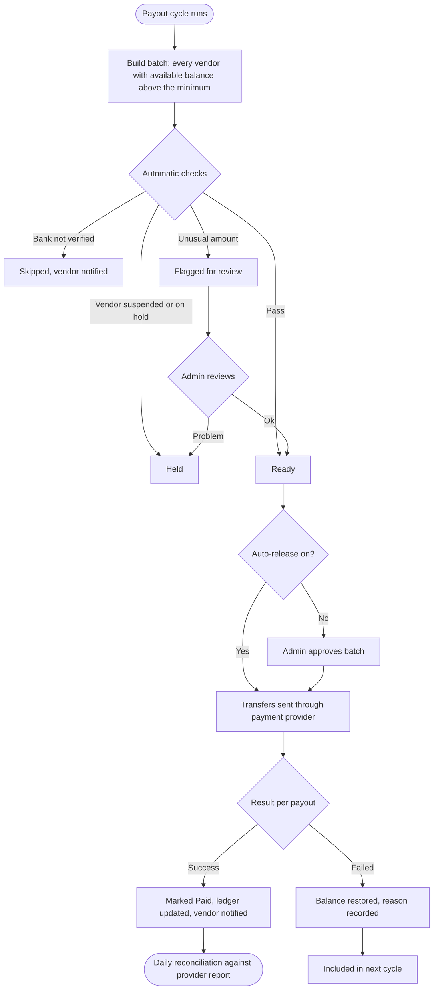

# Payouts

[Docs](../../README.md) / [Flows](../README.md) / [Admin](README.md) / Payouts

Paying vendors and riders. The system prepares payout batches; the admin reviews and
releases them.

## Flow

## Actions

| Screen | Element | Admin does | What happens | Leads to |
|---|---|---|---|---|
| Payouts | Batch row | Clicks | Shows payouts in the batch with status and totals | Batch detail |
| Batch detail | Payout row | Clicks | Lists the orders included, commission deducted, adjustments and net amount | Payout detail |
| Batch detail | **Approve batch** | Clicks, confirms with password | All Ready payouts are sent to the payment provider | Batch detail, status Processing |
| Batch detail | Flagged payout **Approve** / **Hold** | Clicks with a note | Approve moves it to Ready; Hold keeps the balance in the wallet | Batch detail |
| Payout detail | **Hold** + reason | Clicks | The vendor's payouts stop until released; the vendor sees "On hold" | Payout detail |
| Payout detail | **Release** | Clicks | Included in the next cycle | Payout detail |
| Payout detail | **Add adjustment** | Enters amount (plus or minus) and reason | A ledger entry is posted to the vendor's wallet | Payout detail |
| Failed tab | Failed payout | Clicks | Shows the bank's failure reason | Payout detail |
| Failed tab | **Retry now** | Clicks | Sends the transfer again immediately | Batch detail |
| Reconciliation | Mismatch row | Clicks | Shows the ledger figure against the provider's figure | Mismatch detail |
| Settings | Cycle, minimum payout, hold period, auto-release | Edits | Applies from the next cycle | Stays |

## Rules and edge cases

- **Hold period:** an order's earning becomes payable 2 days after delivery, so refund requests can be handled first.
- **Unusual amount:** a payout more than three times the vendor's recent average is flagged.
- **Negative balances** are never paid out; they are carried forward.
- **Two-person rule:** above an admin-set batch total, a second admin must approve.
- **Rider payouts** run weekly through the same screens with cash-in-hand deducted.
- **Reconciliation mismatch** blocks the next batch for that vendor until resolved.

## Related

- [Vendor: earnings and payouts](../vendor/earnings-and-payouts.md)
- [System: money flow](../system/money-flow.md)
