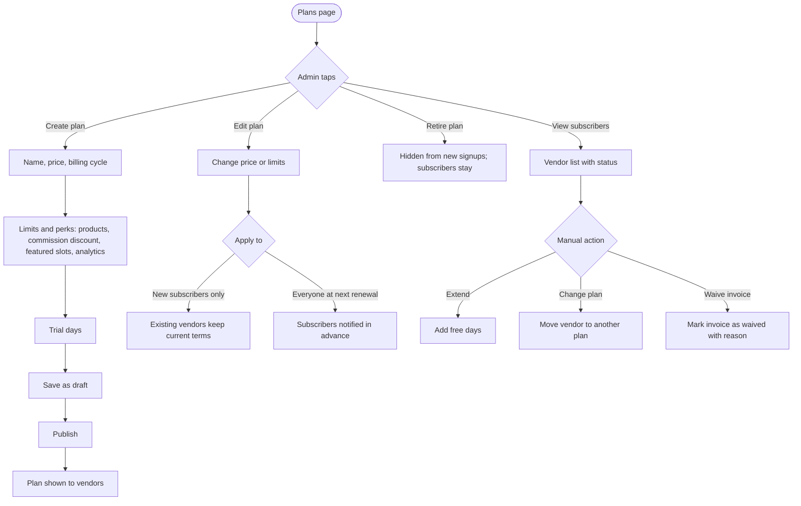

# Subscription plans

[Docs](../../README.md) / [Flows](../README.md) / [Admin](README.md) / Subscription plans

The admin defines the plans vendors subscribe to.

## Flow

## Actions

| Screen | Element | Admin does | What happens | Leads to |
|---|---|---|---|---|
| Plans | **Create plan** | Taps | Form opens | Plan form |
| Plan form | Name, description, price, cycle (monthly, yearly) | Fills | Price 0 makes a free plan | Stays |
| Plan form | Product limit | Enters a number or Unlimited | Enforced when a vendor adds a product | Stays |
| Plan form | Commission discount | Enters points (for example 2) | Subtracted from the commission rate on the vendor's orders | Stays |
| Plan form | Featured slots | Enters a number | How many of the vendor's products or the store itself can appear in sponsored placements | Stays |
| Plan form | Analytics level, staff accounts | Selects | Unlocks dashboard features | Stays |
| Plan form | Trial days | Enters | New subscribers are not charged until the trial ends | Stays |
| Plan form | **Save draft** | Taps | Saved but invisible to vendors | Plans |
| Plans | **Publish** | Taps, confirms | Plan is created at the payment provider and appears in the vendor plan list | Plans |
| Plans | Drag handle | Drags | Sets display order; one plan can be marked "Recommended" | Stays |
| Plans | **Edit** on a published plan | Changes values | Asks whether it applies to new subscribers only or to everyone at renewal | Apply dialog |
| Plans | **Retire** | Taps, confirms | Plan can no longer be chosen; current subscribers continue | Plans |
| Subscribers | Filter by plan and status | Selects | Lists vendors: Active, Trialing, Past due, Grace, Cancelled | Stays |
| Subscribers | Vendor row **Extend** | Enters days and reason | Renewal date moves; recorded in the audit log | Subscribers |
| Subscribers | Vendor row **Change plan** | Picks a plan | Applied immediately without charge; used for support cases | Subscribers |

## Rules and edge cases

- **One free plan must always exist** as the fallback when a paid plan expires.
- **Price increases** need at least 7 days' notice to subscribers before their renewal.
- **Lowering a limit** never deletes vendor data; it only blocks adding more.
- **Deleting:** a plan that has ever had a subscriber can only be retired.
- **Revenue reporting:** plan revenue is reported separately from commission revenue.

## Related

- [Vendor: subscription](../vendor/subscription.md)
- [System: subscription lifecycle](../system/subscription-lifecycle.md)
