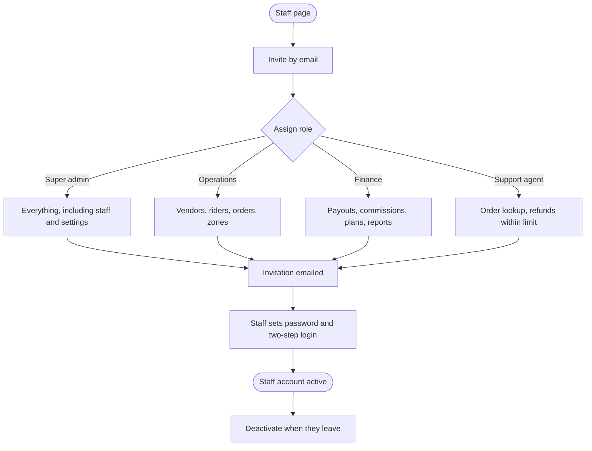

# Riders, users and reports

[Docs](../../README.md) / [Flows](../README.md) / [Admin](README.md) / Riders, users and reports

Approving riders, managing customers and staff accounts, and reading reports.

## Staff and roles flow

## Actions

| Screen | Element | Admin does | What happens | Leads to |
|---|---|---|---|---|
| Riders | **Applications** tab | Opens | Rider applications, oldest first | Stays |
| Rider application | Documents **Verified** / **Flag** | Clicks per document | Same review pattern as vendor approval | Stays |
| Rider application | **Approve** / **Reject** / **Request changes** | Clicks | Rider is notified; approved riders can go online | Riders |
| Riders | Rider row | Clicks | Shows trips, rating, acceptance rate, cash in hand, documents | Rider detail |
| Rider detail | **Suspend** + reason | Clicks | Rider is taken offline and cannot receive offers | Rider detail |
| Riders | **Live map** | Opens | Shows online riders and active jobs by zone | Live map |
| Customers | Search by phone, email, name | Types | Finds the customer | Customer detail |
| Customer detail | Orders, refunds, addresses | Views | Read-only history | Stays |
| Customer detail | **Block** + reason | Clicks | Customer cannot log in or order; open orders finish | Customer detail |
| Customer detail | **Disable COD** | Clicks | Cash on delivery is hidden for this customer | Customer detail |
| Staff | **Invite** | Enters email, picks role | An invitation link valid for 48 hours is emailed | Staff |
| Staff | Role dropdown on a row | Changes | Permissions change at the person's next request | Staff |
| Staff | **Deactivate** | Clicks | All sessions end immediately | Staff |
| Reports | Report type: sales, commission, plan revenue, vendors, riders, refunds | Selects | Chart and table load for the chosen period | Report view |
| Report view | Filters: date range, city, zone, category, store | Selects | Figures reload | Stays |
| Report view | **Export** | Clicks | CSV is generated in the background and emailed when large | Download |
| Audit log | Filters: staff member, action, date | Selects | Lists actions with before and after values | Stays |

## Reports available

| Report | Answers |
|---|---|
| Sales | Orders and order value by day, city, category, store |
| Commission | Commission earned by category and store |
| Plan revenue | Subscription income, new, churned and past-due vendors |
| Vendors | Acceptance rate, prep time, rating, cancellations |
| Riders | Deliveries, delivery time, acceptance rate, rating |
| Refunds | Refund count and amount by reason and by who was at fault |

## Rules and edge cases

- **Least privilege:** a staff member sees only the menu items their role allows.
- **Two-step login** is mandatory for every staff account.
- **The audit log cannot be edited or deleted** by anyone, including super admins.
- **The last super admin** cannot be deactivated or downgraded.
- **Report figures come from the ledger and orders tables,** read from a replica so reports never slow down ordering.

## Related

- [Rider: onboarding](../rider/onboarding.md)
- [Roles](../../product/roles.md)
