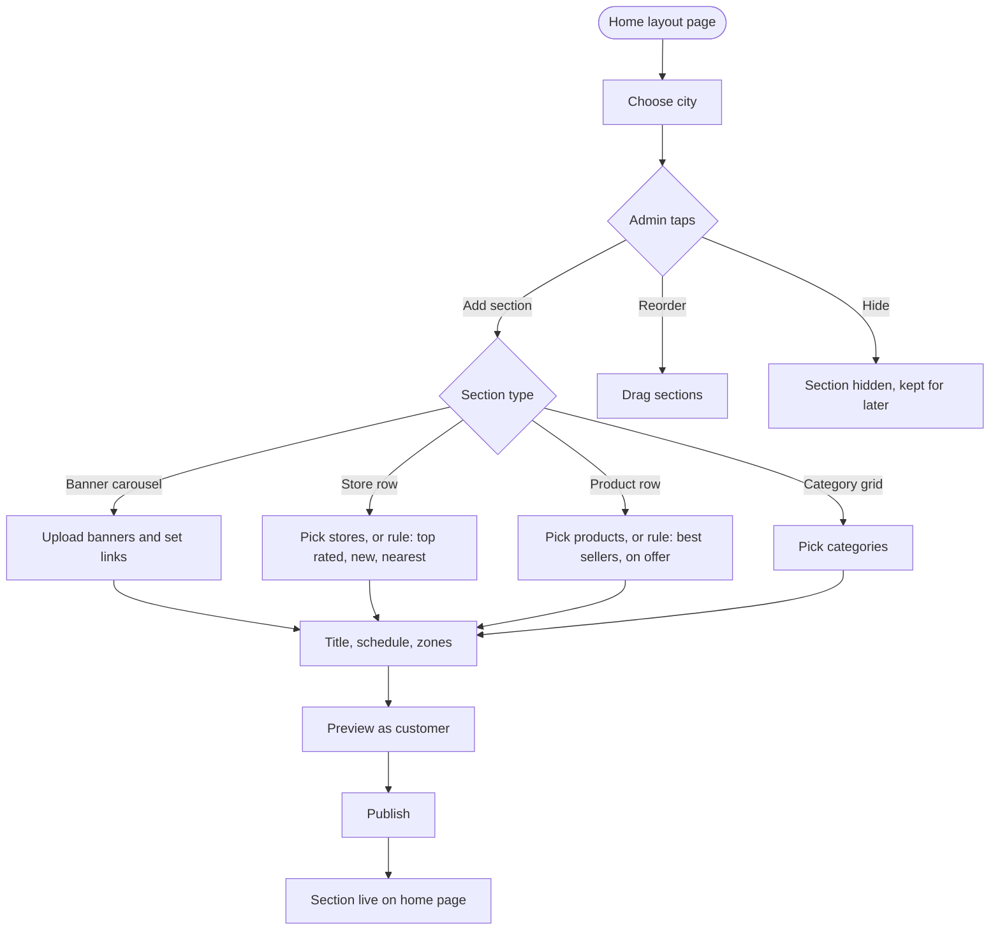
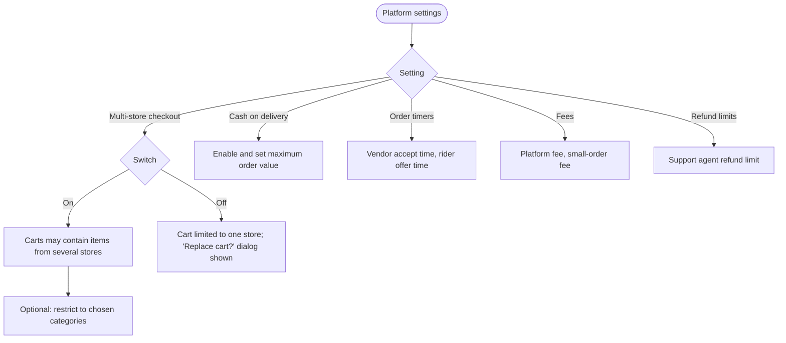

# Storefront

[Docs](../../README.md) / [Flows](../README.md) / [Admin](README.md) / Storefront

What customers see on the home page, and the platform-wide switches that change how
ordering works.

## Featured sections flow

## Platform settings flow

## Actions

| Screen | Element | Admin does | What happens | Leads to |
|---|---|---|---|---|
| Home layout | City selector | Picks | Shows that city's sections in order | Stays |
| Home layout | **Add section** | Picks a type | Section editor opens | Section editor |
| Section editor | Banner upload + link target | Uploads, picks a store, category, product or URL | Tapping the banner opens the target | Stays |
| Section editor | Manual pick or rule | Chooses | A rule (top rated, best sellers) refreshes itself; a manual list stays fixed | Stays |
| Section editor | Schedule | Sets start and end, or days and hours | Section appears only in that window (for example a breakfast row) | Stays |
| Section editor | Zones | Ticks | Limits the section to chosen zones | Stays |
| Section editor | **Preview** | Taps | Shows the home page as a customer in that city would see it | Preview |
| Section editor | **Publish** | Taps | Section goes live; home page cache is cleared | Home layout |
| Home layout | Drag handle | Drags | Order on the home page changes | Stays |
| Home layout | **Hide** toggle | Switches | Section is hidden without being deleted | Stays |
| Platform settings | **Multi-store checkout** switch | Switches | On: mixed carts allowed. Off: adding from a second store prompts to replace the cart | Stays |
| Platform settings | Multi-store categories | Ticks categories | Mixed carts allowed only among stores in those categories | Stays |
| Platform settings | COD maximum | Enters | COD is hidden above this order value | Stays |
| Platform settings | Timers and fees | Enters | Applied to new orders | Stays |

## Rules and edge cases

- **Sponsored placement:** stores using a plan's featured slots are inserted into store rows and labelled "Sponsored".
- **Empty section:** a section with nothing to show for a customer (no matching store in their zone) is skipped.
- **Turning multi-store checkout off** does not break existing mixed carts mid-payment; it applies to carts from the next change.
- **Settings changes** take effect on new orders only and are recorded in the audit log.

## Related

- [Customer: home and search](../customer/home-and-search.md)
- [System: multi-store checkout](../system/multi-store-checkout.md)
