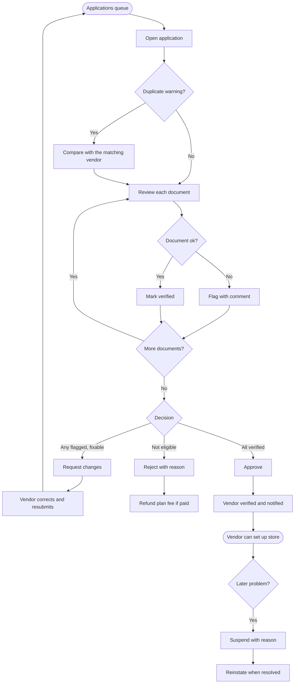

# Vendor approval

[Docs](../../README.md) / [Flows](../README.md) / [Admin](README.md) / Vendor approval

Reviewing vendor applications and managing vendors after they are live.

## Flow

## Actions

| Screen | Element | Admin does | What happens | Leads to |
|---|---|---|---|---|
| Applications | Tabs: New, Changes requested, Approved, Rejected | Switches | Filters applications; New is sorted oldest first | Stays |
| Applications | Application row | Clicks | Opens the application and locks it to this admin so two people do not review it at once | Application detail |
| Application detail | Document thumbnail | Clicks | Opens the file through a short-lived private link | Document viewer |
| Document viewer | **Verified** | Clicks | That document is ticked | Next document |
| Document viewer | **Flag** + comment | Clicks, types | The comment will be shown to the vendor | Next document |
| Application detail | Map pin | Views | Shows the store location and which zone it falls in | Stays |
| Application detail | **Request changes** | Clicks | Status becomes Changes requested; the vendor gets the comments by SMS and email | Applications |
| Application detail | **Reject** + reason | Clicks, selects | Status becomes Rejected; a paid plan fee is refunded | Applications |
| Application detail | **Approve** | Clicks | Enabled only when every required document is verified. Status becomes Verified and the vendor is notified | Applications |
| Vendors | Vendor row | Clicks | Shows profile, documents, plan, orders, ratings, payouts | Vendor detail |
| Vendor detail | **Suspend** + reason | Clicks, confirms | Store is hidden, new orders stop, open orders finish, payouts are held | Vendor detail |
| Vendor detail | **Reinstate** | Clicks | Store returns to its previous state | Vendor detail |
| Vendor detail | **Log in as vendor** | Clicks | Opens a read-only view of the vendor's dashboard for support; the action is audited | Vendor dashboard (read-only) |

## Rules and edge cases

- **Duplicate warning** is raised when the phone, GST number or bank account matches another vendor.
- **Stale applications:** New applications older than 48 hours are highlighted.
- **Document expiry:** licences with an expiry date trigger a reminder to the vendor 30 days before, and suspension if they lapse.
- **Changes after approval:** a vendor changing bank account or business registration returns to review for that item only.
- **Automatic flags:** an acceptance rate under a threshold or repeated refund-causing orders puts the vendor on a watch list.

## Related

- [Vendor: onboarding](../vendor/onboarding.md)
