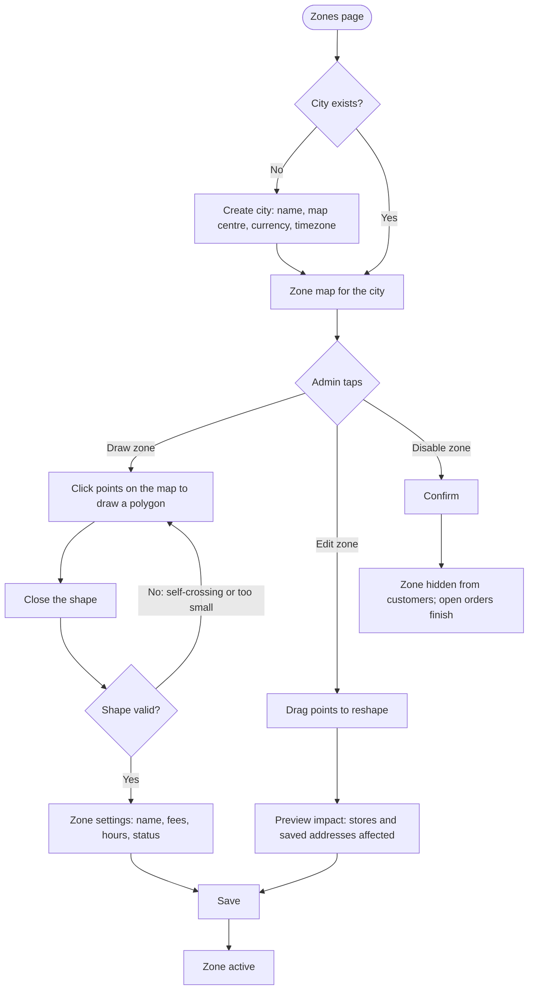

# Delivery zones

[Docs](../../README.md) / [Flows](../README.md) / [Admin](README.md) / Delivery zones

Zones are the geo-fences that decide which stores a customer sees and whether an address
can be served. They are drawn by the admin on a map.

## Flow

## Actions

| Screen | Element | Admin does | What happens | Leads to |
|---|---|---|---|---|
| Zones | City selector | Picks a city | Map centres on it and shows its zones as coloured shapes | Stays |
| Zones | **Add city** | Fills name, centre, timezone | City is created; it has no zones yet so nothing is served | Zone map |
| Zone map | **Draw zone** | Clicks points, double-clicks to close | The polygon is drawn on the map; it is checked for self-crossing lines and minimum area | Zone settings |
| Zone settings | Name | Types | Shown to vendors when they choose zones | Stays |
| Zone settings | Default delivery fee, per-km fee, minimum order | Enters | Used at checkout when a store has not set its own | Stays |
| Zone settings | Service hours | Sets | Outside these hours the zone takes no orders | Stays |
| Zone settings | **Save** | Taps | Polygon is stored as a geo shape with a spatial index; customers in it start seeing its stores | Zone map |
| Zone map | A zone shape | Clicks | Shows its settings, store count and orders today | Side panel |
| Side panel | **Edit shape** | Drags points | Before saving, a preview counts stores and customer addresses that would fall outside | Impact dialog |
| Impact dialog | **Confirm** | Taps | New shape is saved; affected vendors are notified | Zone map |
| Side panel | **Disable** | Taps, confirms | Zone stops taking new orders; orders in progress complete | Zone map |
| Zone map | **Demand layer** toggle | Switches on | Shows "notify me" requests from unserved areas as a heat layer | Stays |

## Rules and edge cases

- **Overlap is allowed:** two zones may overlap; a store is shown if any of its zones contains the customer's point.
- **Deleting:** a zone with stores or order history cannot be deleted, only disabled.
- **Shrinking a zone:** saved addresses now outside it remain saved but show "not serviceable".
- **Pausing for weather or events:** a zone can be paused with a customer-facing message and resumes with one tap.
- **Rider coverage:** riders are offered jobs only in zones of their own city.

## Related

- [Customer: address and location](../customer/address-and-location.md)
- [Vendor: store setup](../vendor/store-setup.md)
