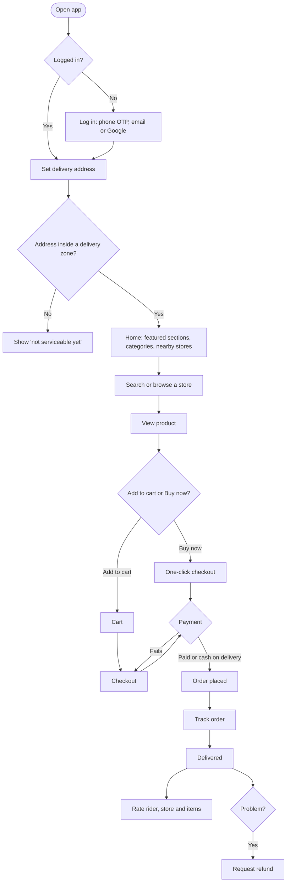

# Customer flows

[Docs](../../README.md) / [Flows](../README.md) / Customer

The customer uses the customer web app. This page shows the whole journey; each step links
to a detailed file that lists every action and what happens.

## Journey

## Detailed flows

| # | Flow | Screens covered |
|---|---|---|
| 1 | [Login and signup](login.md) | Login, OTP, profile setup |
| 2 | [Address and location](address-and-location.md) | Location prompt, address picker, add address |
| 3 | [Home and search](home-and-search.md) | Home, category, search, store page |
| 4 | [Product and cart](product-and-cart.md) | Product page, cart |
| 5 | [Checkout and payment](checkout-and-payment.md) | Checkout, payment, order confirmation, Buy now |
| 6 | [Order tracking](order-tracking.md) | Order list, order detail, live tracking, cancel |
| 7 | [Reviews and refunds](reviews-and-refunds.md) | Rating screen, refund request |
| 8 | [Account](account.md) | Profile, addresses, notifications, logout |
