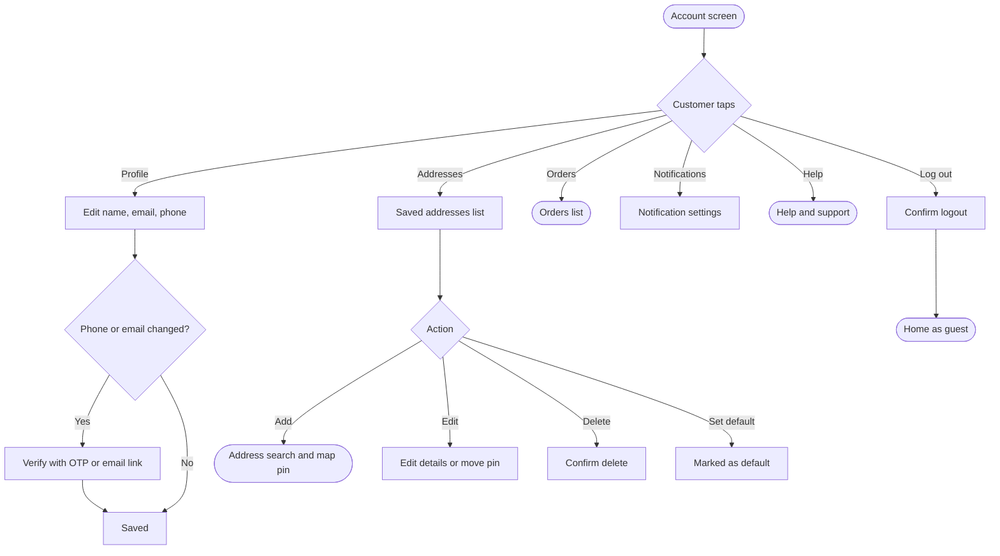

# Account

[Docs](../../README.md) / [Flows](../README.md) / [Customer](README.md) / Account

Profile, saved addresses, notification settings and logout.

## Flow

## Actions

| Screen | Element | Customer does | What happens | Leads to |
|---|---|---|---|---|
| Account | **Profile** | Taps | Loads current details | Profile form |
| Profile | Name + **Save** | Edits, taps | Name is updated | Account |
| Profile | Phone **Change** | Enters new number | An OTP is sent to the new number; the change applies only after it is verified | OTP screen |
| Profile | Email **Change** | Enters new email | A verification link is emailed; the old email stays until it is clicked | "Check your email" |
| Addresses | **Add new address** | Taps | Starts the address flow | [Address and location](address-and-location.md) |
| Addresses | Address **Edit** | Taps | Opens details; moving the pin re-runs the zone check | Address form |
| Addresses | Address **Delete** | Taps, confirms | Address is removed. Past orders keep their own copy of the address | Addresses |
| Addresses | **Set as default** | Taps | This address is used at app open and for Buy now | Addresses |
| Notifications | Toggles: order updates, offers | Switches | Preference saved. Order updates by SMS cannot be turned off | Stays |
| Account | **Delete account** | Taps, confirms with OTP | Account is scheduled for deletion; personal data is erased after the legal retention period for invoices | Logged out |
| Account | **Log out** | Taps, confirms | Refresh token is revoked and the device's push token is removed | Home as guest |

## Rules and edge cases

- **Deleting the default address:** the most recently used remaining address becomes the default.
- **Deleting an address with an active order:** allowed; the order holds its own copy.
- **Phone already used by another account:** the change is refused with "This number is already registered".
- **Account deletion with an active order or open refund:** blocked until those finish.

## Related

- [Login and signup](login.md)
- [Security and compliance](../../architecture/security.md)
