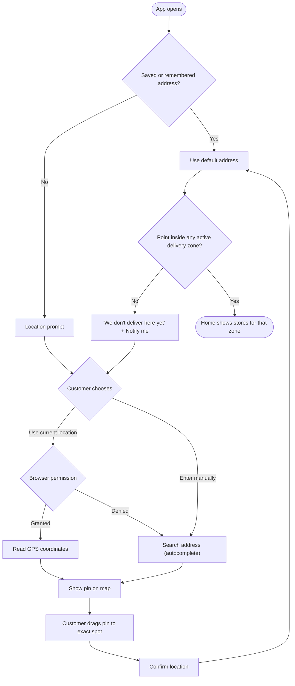

# Address and location

[Docs](../../README.md) / [Flows](../README.md) / [Customer](README.md) / Address and location

Everything the customer sees depends on their delivery address: only stores whose delivery
zone contains that address are shown.

## Flow

## Actions

| Screen | Element | Customer does | What happens | Leads to |
|---|---|---|---|---|
| Location prompt | **Use my current location** | Taps | Browser asks for location permission. On grant, coordinates are read and reverse-geocoded into an address | Map pin screen |
| Location prompt | **Enter address manually** | Taps | Search box opens | Address search |
| Address search | Search box | Types 3+ characters | Google Places suggestions appear, limited to the launch country | Suggestion list |
| Address search | A suggestion | Taps | The place is geocoded to coordinates | Map pin screen |
| Map pin | Map | Drags the map under the pin | The address line updates as the pin settles | Stays |
| Map pin | **Confirm location** | Taps | Coordinates are checked against delivery zones | Home, or "not serviceable" |
| Address details (logged in) | Flat/house, landmark, label (Home, Work, Other), **Save** | Fills and taps | Address is saved to the account with its coordinates and zone | Home |
| Header | Address chip | Taps | Address picker opens with saved addresses | Address picker |
| Address picker | A saved address | Taps | It becomes the active address; stores, prices and delivery fees reload | Home |
| Address picker | **Add new address** | Taps | Starts the search flow above | Address search |
| Not serviceable | **Notify me** | Taps | The location and contact are stored so the admin can see demand by area | Confirmation message |

## Rules and edge cases

- **Guest:** the chosen location is remembered on the device only; it is saved to the account after login.
- **Changing address with items in the cart:** each cart item's store is re-checked. Items from stores that do not deliver to the new address are flagged and must be removed before checkout.
- **Zone check:** uses the pin's coordinates, not the typed text, so a wrong pin can block delivery. The map step is therefore mandatory for a new address.
- **Overlapping zones:** if a point falls in two zones, the store's own zone assignment decides which stores appear.
- **Limit:** 10 saved addresses per customer.

## Related

- Managing saved addresses: [Account](account.md)
- How zones are drawn: [Admin: delivery zones](../admin/zones.md)
