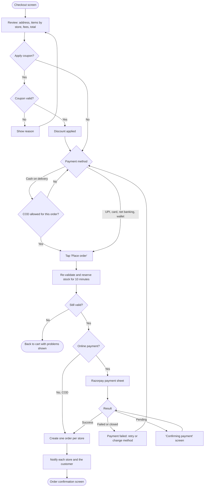

# Checkout and payment

[Docs](../../README.md) / [Flows](../README.md) / [Customer](README.md) / Checkout and payment

One checkout and one payment, even when the cart spans several stores. After payment the
checkout becomes one order per store.

## Flow

## Actions

| Screen | Element | Customer does | What happens | Leads to |
|---|---|---|---|---|
| Checkout | Address card **Change** | Taps | Address picker opens; on change, delivery fees and store availability are recalculated | Checkout |
| Checkout | Delivery instructions | Types | Saved with the order and shown to the rider | Stays |
| Checkout | Coupon field **Apply** | Enters code, taps | Code is checked: active, not expired, minimum order met, usage limit, applicable stores or categories | Discount line, or reason for rejection |
| Checkout | Applied coupon **Remove** | Taps | Discount is removed and totals recalculated | Stays |
| Checkout | Bill details row | Taps | Expands: item total, delivery fee per store, taxes, discount, grand total | Stays |
| Checkout | Payment method list | Selects one | Choice is remembered as the default for next time | Stays |
| Checkout | **Place order** | Taps | Button disables to prevent a double tap. The server re-validates the cart, reserves stock, creates the checkout with an idempotency key, and creates the gateway payment | Payment sheet, or confirmation for COD |
| Payment sheet | UPI app / card form | Completes payment | Razorpay processes it and notifies the server by webhook; the server verifies the signature and amount | Confirmation |
| Payment sheet | Close (X) | Taps | Payment is abandoned; reserved stock is released | "Payment failed" with **Retry** |
| Payment failed | **Retry** | Taps | A new payment attempt is created for the same checkout | Payment sheet |
| Payment failed | **Change method** | Taps | Returns to the method list | Checkout |
| Confirmation | Order cards (one per store) | Taps one | Opens that order | [Order tracking](order-tracking.md) |
| Confirmation | **Continue shopping** | Taps | Cart is already empty | Home |

## Buy now (one-click checkout)

**Buy now** on a product page creates a checkout for that single item using the default
address and the last-used payment method, then shows a compact confirm sheet with the total
and one **Pay** button. The rest of the flow is identical. If the customer has no saved
address or payment method, they are sent to the full checkout instead.

## Rules and edge cases

- **Idempotency:** tapping Place order twice, or a network retry, never creates two checkouts or two charges.
- **Money taken but app closed:** the webhook still confirms the payment and creates the orders; the customer sees them under Orders.
- **Payment pending:** the checkout waits up to 10 minutes for the gateway's final answer. Success creates the orders; failure or timeout releases stock and any captured amount is refunded automatically.
- **COD limits:** cash on delivery is offered only below an admin-set order value and can be disabled per store or per customer.
- **Coupon with several stores:** a platform coupon's discount is split across stores in proportion to their subtotals; a store's own coupon applies only to that store's items.
- **Who pays for a coupon:** every coupon is marked platform-funded, vendor-funded or co-funded, and each store's order records its share. See [Discounts and fees](../../product/monetization.md#discounts-and-fees).
- **One store fails validation:** the whole checkout stops and the customer fixes the cart; nothing is charged.

## Related

- Next step: [Order tracking](order-tracking.md)
- [System: multi-store checkout](../system/multi-store-checkout.md), [Money flow](../system/money-flow.md)
