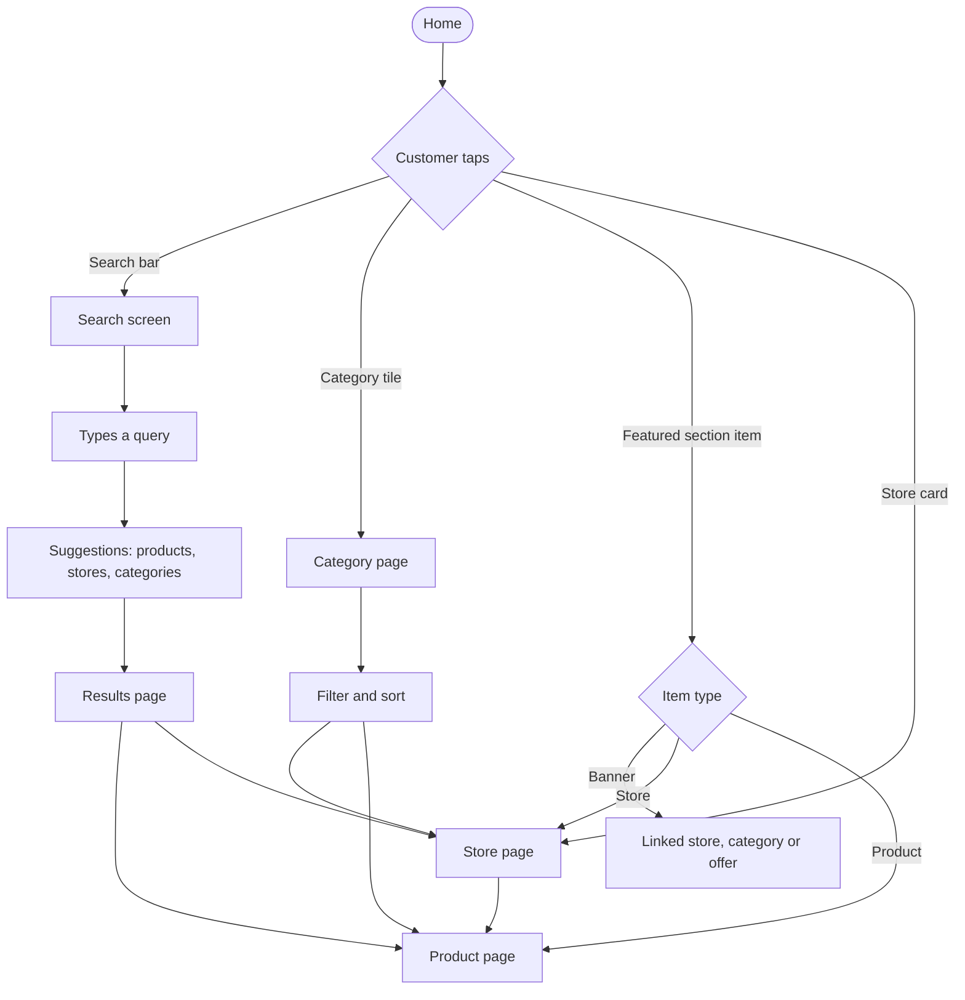

# Home and search

[Docs](../../README.md) / [Flows](../README.md) / [Customer](README.md) / Home and search

How a customer finds a store or a product. Every list is filtered to stores that deliver to
the active address.

## Flow

## Actions

| Screen | Element | Customer does | What happens | Leads to |
|---|---|---|---|---|
| Home | Search bar | Taps | Search screen opens showing recent searches and popular searches in the area | Search |
| Home | Category tile | Taps | Loads stores and products in that category for the active zone | Category page |
| Home | Banner | Taps | Opens whatever the admin linked: a store, category, product or offer | Linked page |
| Home | Store card in a featured row | Taps | Opens the store | Store page |
| Home | Product card **Add** button | Taps | Adds one unit to the cart without leaving home; the button becomes a quantity stepper | Stays; cart badge updates |
| Home | Pull to refresh | Pulls down | Reloads sections and store availability | Stays |
| Search | Text field | Types 2+ characters | After a 200 ms pause, suggestions load from the search engine with typo tolerance | Suggestion list |
| Search | A suggestion | Taps | Product suggestion opens the product; store opens the store; a phrase runs the full search | Product, store or results |
| Search | Enter key | Presses | Full results load; the query is saved to recent searches | Results page |
| Results | **Products / Stores** tabs | Switches | Shows matching products or matching stores | Stays |
| Results / Category | Filter chips (price, rating, veg, offers) and Sort | Taps | List reloads with the filter applied; the filter is kept while browsing | Stays |
| Results / Category | Scrolls to bottom | Scrolls | Next page of 20 loads | Stays |
| Store page | Category tabs | Taps | Jumps to that section of the store's menu | Stays |
| Store page | Search within store | Types | Filters this store's products only | Stays |
| Store page | Product row | Taps | Opens product details | Product page |
| Store page | Info icon | Taps | Shows hours, address, rating, verified badge, delivery fee and ETA | Info sheet |

## Rules and edge cases

- **Closed store:** shown greyed with "Opens at …"; products can be viewed but not added to the cart.
- **Out of stock:** product shows "Out of stock" and the Add button is disabled.
- **No results:** shows "No matches" with popular categories and a spelling-corrected suggestion when one exists.
- **Home layout:** sections, their order and their schedule come from the admin's featured-section setup for the customer's city.
- **Ranking:** search ranks by text match, then store rating and distance; featured-slot stores from paid plans are labelled "Sponsored".
- **Empty zone:** if no store is active in the zone, home shows "Stores coming soon" instead of empty rows.

## Related

- Next step: [Product and cart](product-and-cart.md)
- [Admin: storefront](../admin/storefront.md)
