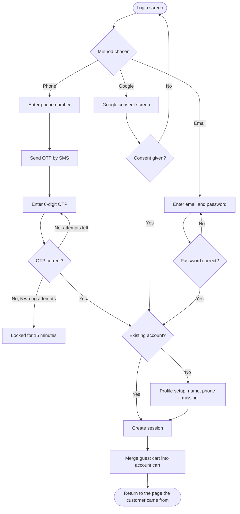

# Login and signup

[Docs](../../README.md) / [Flows](../README.md) / [Customer](README.md) / Login and signup

A customer can browse without an account. Login is required to check out, see orders or
save an address. Signup and login are the same flow: a new phone number or email creates
the account.

## Flow

## Actions

| Screen | Element | Customer does | What happens | Leads to |
|---|---|---|---|---|
| Login | Phone number field + **Continue** | Enters number, taps Continue | Number is validated (10 digits). An OTP is generated, stored hashed with a 5-minute expiry, and sent by SMS | OTP screen |
| Login | **Continue with Google** | Taps | Google consent opens. On return the backend verifies Google's token and finds the account by email, or creates one | Profile setup (new) or previous page |
| Login | **Use email instead** | Taps | Email and password fields appear | Email form |
| Login | **Skip** | Taps | Nothing is saved; the customer continues as a guest | Home |
| OTP | 6 input boxes | Types the code | Auto-submits on the 6th digit. If correct, the OTP is deleted and a session is issued | Profile setup or previous page |
| OTP | **Resend OTP** | Taps after the 30-second timer | A new OTP is sent and the old one stops working | Stays on OTP screen |
| OTP | **Change number** | Taps | The pending OTP is discarded | Login |
| Email form | **Log in** | Enters email and password | Password is checked against the stored hash | Previous page, or error under the field |
| Email form | **Forgot password** | Taps | A reset link valid for 30 minutes is emailed. The response is the same whether or not the email exists | "Check your email" message |
| Profile setup | Name, phone (if Google or email signup) + **Save** | Fills and taps | Profile is created. A phone number added here is verified by OTP | Previous page |

## Rules and edge cases

- **OTP limits:** 3 sends per number per 10 minutes; 5 wrong attempts lock the number for 15 minutes.
- **Session:** a 15-minute access token and a 30-day refresh token that rotates on every use. Logging out revokes the refresh token.
- **Guest cart:** items added before login are merged into the account's cart; on a clash the higher quantity wins.
- **Same person, two methods:** a Google login whose email matches an existing account links to that account; it does not create a second one.
- **Blocked account:** a customer blocked by an admin sees "Account suspended, contact support" and no session is created.
- **SMS not delivered:** after two resends the screen offers Google or email login as an alternative.

## Related

- Next step: [Address and location](address-and-location.md)
- [Security](../../architecture/security.md)
