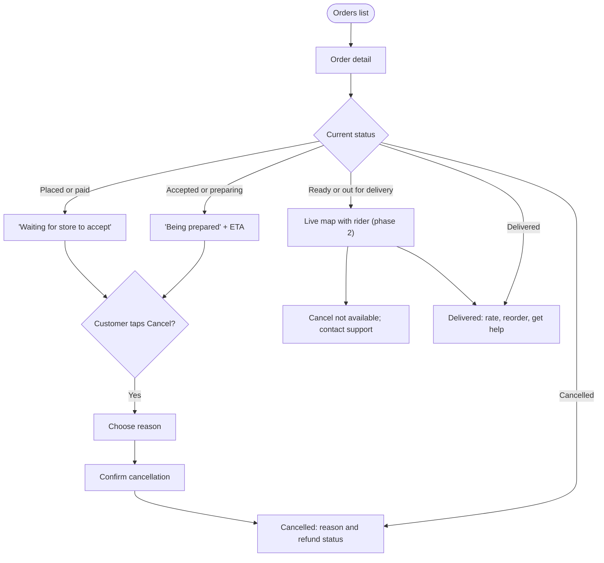

# Order tracking

[Docs](../../README.md) / [Flows](../README.md) / [Customer](README.md) / Order tracking

Each store's order is tracked separately, even when several came from one checkout.

## Flow

## Actions

| Screen | Element | Customer does | What happens | Leads to |
|---|---|---|---|---|
| Orders list | **Active / Past** tabs | Switches | Shows orders in progress or finished ones | Stays |
| Orders list | Order card | Taps | Loads the order and opens a live connection for status updates | Order detail |
| Order detail | Status timeline | Views | Each step shows its time; updates arrive without refreshing | Stays |
| Order detail | **Cancel order** (visible until the store marks it ready) | Taps | Reason sheet opens | Reason sheet |
| Reason sheet | Reason + **Confirm** | Selects, taps | Order moves to Cancelled, stock is released, the store is notified, and a refund starts if the order was paid | Order detail showing Cancelled |
| Order detail | **Call store** | Taps | Opens the phone dialer with a masked number | Dialer |
| Order detail | **Call rider** (after pickup) | Taps | Opens the dialer with a masked number | Dialer |
| Order detail | Live map (phase 2) | Views | Rider's position updates every few seconds with a refreshed ETA | Stays |
| Order detail | Delivery OTP | Reads to the rider | The rider enters it to confirm delivery | Status becomes Delivered |
| Order detail | **View bill** | Taps | Shows items, fees, taxes, discount and payment method; **Download invoice** saves a PDF | Bill sheet |
| Order detail | **Get help** | Taps | Lists issue types for this order | [Reviews and refunds](reviews-and-refunds.md) |
| Order detail (delivered) | **Reorder** | Taps | Adds the same items to the cart at today's prices; unavailable items are listed | Cart |
| Order detail (delivered) | **Rate order** | Taps | Opens the rating screen | [Reviews and refunds](reviews-and-refunds.md) |
| Push notification | Notification | Taps | Opens the order it refers to | Order detail |

## Notifications sent to the customer

| Event | Channel |
|---|---|
| Order placed | Push, SMS |
| Store accepted / rejected | Push |
| Order ready, rider assigned | Push |
| Out for delivery | Push, SMS with delivery OTP |
| Delivered | Push |
| Cancelled or refunded | Push, SMS |

## Rules and edge cases

- **Cancellation window:** the customer can cancel until the store marks the order ready. After that, only support can cancel.
- **Store does not respond:** if the store neither accepts nor rejects within the time limit, the order is cancelled automatically and refunded.
- **Refund timing:** refunds go back to the original payment method; the screen shows "Refund initiated" and then "Refunded" when the gateway confirms.
- **One of several orders cancelled:** the other stores' orders continue; only the cancelled order's amount is refunded.
- **Connection lost:** the screen falls back to refreshing status every 15 seconds.

## Related

- [System: order lifecycle](../system/order-lifecycle.md)
- [Vendor: orders](../vendor/orders.md), [Rider: jobs and delivery](../rider/jobs-and-delivery.md)
