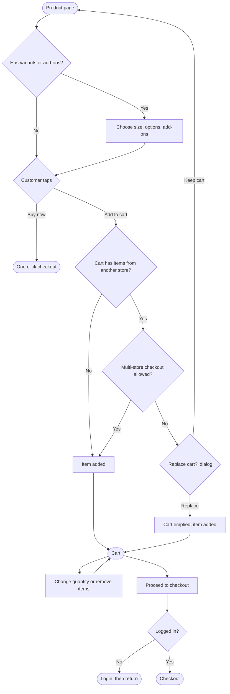

# Product and cart

[Docs](../../README.md) / [Flows](../README.md) / [Customer](README.md) / Product and cart

## Flow

## Actions

| Screen | Element | Customer does | What happens | Leads to |
|---|---|---|---|---|
| Product | Image gallery | Swipes | Next image shows | Stays |
| Product | Variant selector (size, weight) | Taps an option | Price, stock and image update for that variant | Stays |
| Product | Add-on checkboxes | Ticks | Add-on price is added to the shown total | Stays |
| Product | Quantity stepper | Taps + or − | Quantity changes, capped at available stock and the per-order limit | Stays |
| Product | **Add to cart** | Taps | Stock is checked. The item is saved to the cart (server-side when logged in, on the device for guests) | Stays; "Added" toast with **View cart** |
| Product | **Buy now** | Taps | Skips the cart and creates a one-item checkout with the default address and last payment method | [Checkout and payment](checkout-and-payment.md) |
| Product | Store name | Taps | Opens the store | Store page |
| Product | Reviews section | Taps | Opens all item reviews | Reviews list |
| Replace-cart dialog | **Replace** | Taps | Existing cart items are removed and the new item added | Stays |
| Cart | Quantity stepper | Taps + or − | Line total, store subtotal and grand total recalculate | Stays |
| Cart | − at quantity 1, or bin icon | Taps | Item is removed; **Undo** is offered for 5 seconds | Stays |
| Cart | Note for store field | Types | Saved against that store's part of the order | Stays |
| Cart | **Add more items** (per store) | Taps | Opens that store | Store page |
| Cart | **Proceed to checkout** | Taps | Cart is re-validated: price, stock, store open, address in zone | Checkout, or the cart with problems highlighted |

## Rules and edge cases

- **Multi-store cart:** items are grouped by store, each with its own subtotal and delivery fee.
- **Price changed since adding:** the cart shows the new price with a "price updated" note; the customer must see it before checkout.
- **Item went out of stock:** the line is marked unavailable and blocks checkout until removed.
- **Store closed since adding:** that store's group is marked "closed" and blocks checkout until removed.
- **Minimum order value:** if a store's subtotal is below its minimum, the cart shows how much more to add.
- **Cart lifetime:** a logged-in cart is kept for 30 days; stock is not reserved until payment starts.

## Related

- Next step: [Checkout and payment](checkout-and-payment.md)
- [System: multi-store checkout](../system/multi-store-checkout.md)
