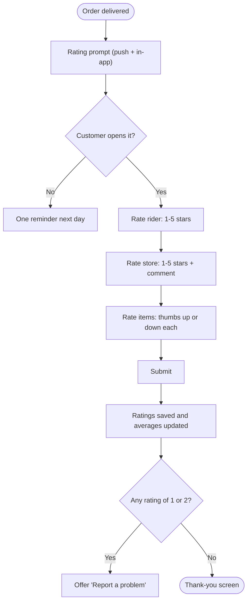
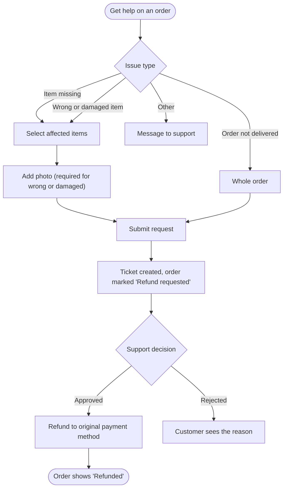

# Reviews and refunds

[Docs](../../README.md) / [Flows](../README.md) / [Customer](README.md) / Reviews and refunds

What a customer can do after delivery: rate the order, or report a problem. Reviews ship in
phase 2; the refund request ships in phase 1.

## Rating flow

## Refund request flow

## Actions

| Screen | Element | Customer does | What happens | Leads to |
|---|---|---|---|---|
| Rating | Rider stars | Taps 1-5 | Selection is held until submit; low ratings show reason chips (late, rude, damaged package) | Stays |
| Rating | Store stars + comment | Taps, types | Same | Stays |
| Rating | Item thumbs | Taps per item | Same | Stays |
| Rating | **Submit** | Taps | Three kinds of review are saved; store, item and rider averages are recalculated | Thank-you screen |
| Rating | **Skip** | Taps | Nothing is saved; the order keeps a **Rate order** button for 7 days | Order detail |
| Get help | Issue type | Taps one | Shows the matching form | Issue form |
| Issue form | Item checkboxes | Ticks affected items | The requested refund amount is calculated from those lines | Stays |
| Issue form | **Add photo** | Picks or takes a photo | Uploaded to private storage and attached to the ticket | Stays |
| Issue form | **Submit** | Taps | A support ticket is created, the order is marked Refund requested, and the store is notified | Ticket status screen |
| Ticket status | Status line | Views | Shows Under review, Approved or Rejected with the reason | Stays |

## Rules and edge cases

- **Who can review:** only the customer who placed a delivered order, once per order. Reviews can be edited for 48 hours.
- **Moderation:** comments pass an abusive-language filter; a store can flag a review for admin moderation but cannot delete it.
- **Refund window:** a problem must be reported within 48 hours of delivery.
- **Partial refund:** refunding some items returns only those lines; the vendor's earning and the platform's commission are reduced in proportion.
- **Cash on delivery orders:** refunds are paid to the customer's UPI ID or bank account collected in the form.
- **Repeated claims:** accounts with frequent refund requests are flagged for support review.

## Related

- [Support: refunds and disputes](../support/refunds-and-disputes.md)
- [System: money flow](../system/money-flow.md)
