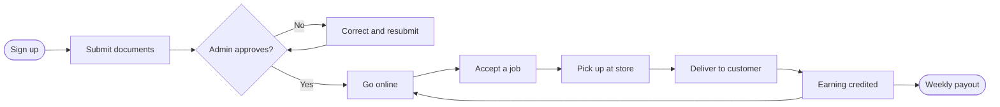

# Rider flows

[Docs](../../README.md) / [Flows](../README.md) / Rider

The rider uses the rider mobile app, which ships in phase 2. Until then vendors deliver
with their own riders from the vendor dashboard.

## Journey

## Detailed flows

| # | Flow | Screens covered |
|---|---|---|
| 1 | [Onboarding](onboarding.md) | Signup, documents, vehicle, bank account, approval status |
| 2 | [Jobs and delivery](jobs-and-delivery.md) | Online switch, job offer, pickup, navigation, delivery proof |
| 3 | [Earnings](earnings.md) | Earnings summary, trip history, cash to deposit, payouts |
