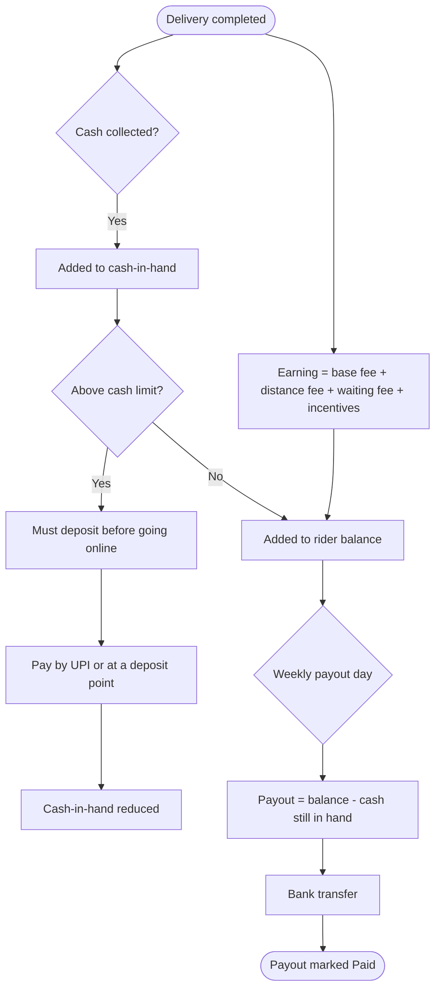

# Rider earnings

[Docs](../../README.md) / [Flows](../README.md) / [Rider](README.md) / Earnings

## Flow

## Actions

| Screen | Element | Rider does | What happens | Leads to |
|---|---|---|---|---|
| Earnings | Summary: today, this week, cash in hand | Views | Computed from the ledger | Stays |
| Earnings | Trip row | Taps | Shows the breakdown: base, distance, waiting, incentive, tip | Trip detail |
| Earnings | Week selector | Selects | Loads that week's trips and payout | Stays |
| Cash | **Deposit cash** | Taps, pays by UPI | Payment is confirmed by the gateway and cash-in-hand is reduced | Cash screen |
| Payouts | Payout row | Taps | Shows trips included, deductions and bank reference | Payout detail |
| Bank account | **Change** | Enters new details, confirms with OTP | Validated; payouts pause 24 hours | Bank account |

## Rules and edge cases

- **Delivery fee rates** (base, per km, waiting) are set by the admin per city.
- **Tips** go to the rider in full.
- **Undelivered order:** the rider is still paid for the trip, plus the return trip if sent back to the store.
- **Cash not deposited by payout day:** it is deducted from that week's payout.
- **Failed payout:** balance is restored and retried the next cycle.

## Related

- [Jobs and delivery](jobs-and-delivery.md)
- [Admin: payouts](../admin/payouts.md)
