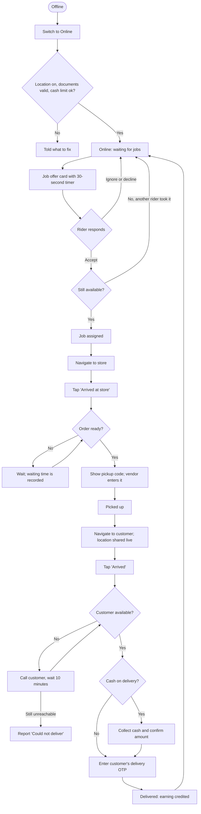

# Rider jobs and delivery

[Docs](../../README.md) / [Flows](../README.md) / [Rider](README.md) / Jobs and delivery

Riders choose their own jobs: an open job is offered to nearby online riders and the first
to accept takes it.

## Flow

## Actions

| Screen | Element | Rider does | What happens | Leads to |
|---|---|---|---|---|
| Home | **Online** switch | Switches on | Checks location permission, document validity and cash-in-hand limit. The rider's location starts being sent every few seconds | Waiting state |
| Home | **Online** switch | Switches off | No new offers. Not allowed while a job is in progress | Offline |
| Job offer | Card: store, drop area, distance, earning, COD amount | Reads | The same offer is shown to several nearby riders | Stays |
| Job offer | **Accept** | Taps | The first accept wins and the job is locked to that rider; others see "Job taken" | Active job |
| Job offer | **Decline** or timer runs out | Taps or waits | The offer disappears; it does not affect the rider unless it happens repeatedly | Waiting |
| Active job | **Navigate** | Taps | Opens Google Maps with the destination | Maps app |
| Active job | **Arrived at store** | Taps | Allowed only within 100 m of the store; the vendor is notified | Pickup screen |
| Pickup | Pickup code (large digits) | Shows it to the vendor | The vendor enters it; order status becomes Out for delivery and the customer is notified | Delivery screen |
| Pickup | Item checklist | Ticks | Rider confirms the package count before leaving | Stays |
| Delivery | **Call customer** | Taps | Dialer opens with a masked number | Dialer |
| Delivery | **Arrived** | Taps | Allowed only near the drop point; the customer is notified | Handover screen |
| Handover | Cash amount **Collected** (COD only) | Confirms | The amount is added to the rider's cash-in-hand balance | OTP field |
| Handover | OTP field + **Complete delivery** | Enters the customer's OTP | Order becomes Delivered; rider earning and vendor earning are credited | Waiting state |
| Handover | **Customer not available** | Taps after trying to call | A 10-minute timer starts; support is alerted | Timer screen |
| Timer screen | **Could not deliver** | Taps when the timer ends | Support decides: return to store or dispose. The rider is paid for the trip | Follow support's instruction |
| Active job | **Report a problem** | Taps | Options: accident, vehicle breakdown, store closed, wrong address. Support is alerted and can reassign the job | Support chat |

## Rules and edge cases

- **Offer radius:** starts at riders within 2 km of the store and widens every 60 seconds until someone accepts.
- **Nobody accepts within 10 minutes:** the vendor and support are alerted.
- **One job at a time** at launch; batching several orders from the same store is a later addition.
- **Rider cancels after accepting:** allowed before pickup with a reason; the job is re-offered. Frequent cancellations lower the rider's priority.
- **OTP not available:** the rider can take a photo as proof instead; these deliveries are flagged for review.
- **Cash-in-hand limit:** when collected cash exceeds the limit, the rider cannot go online until it is deposited.
- **Multi-store checkout:** each store's order is a separate job and may be delivered by different riders.

## Related

- [Vendor: orders](../vendor/orders.md)
- [Customer: order tracking](../customer/order-tracking.md)
- [Earnings](earnings.md)
