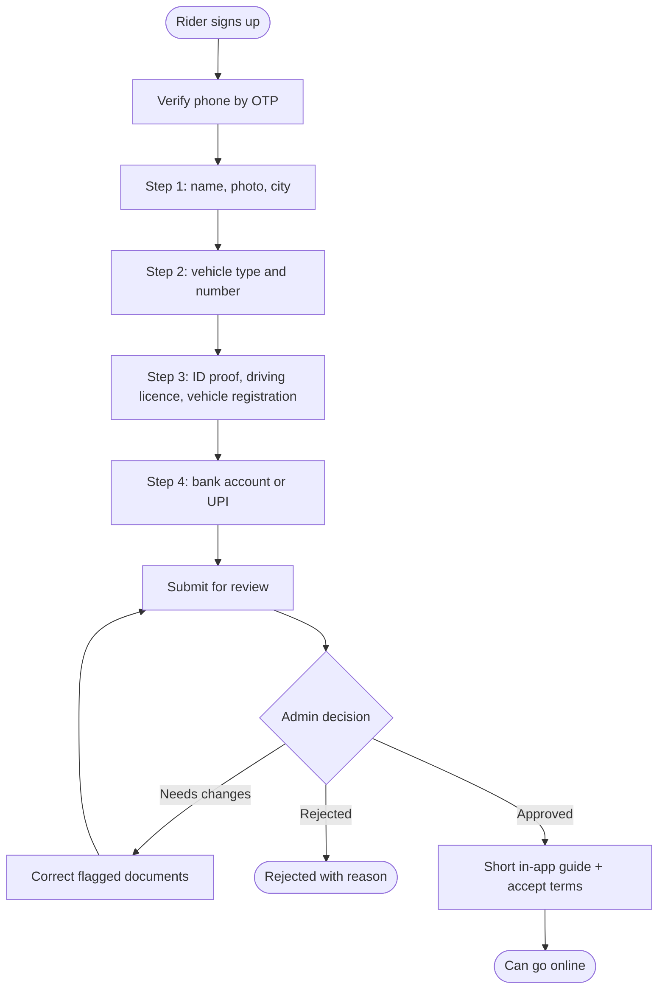

# Rider onboarding

[Docs](../../README.md) / [Flows](../README.md) / [Rider](README.md) / Onboarding

## Flow

## Actions

| Screen | Element | Rider does | What happens | Leads to |
|---|---|---|---|---|
| Signup | Phone + **Get OTP** | Enters number | OTP sent; on verification a rider account is created in Draft status | Step 1 |
| Step 1 | Name, selfie, city, **Next** | Fills, taps | The selfie is stored for identity checks; the city decides which zones the rider can work in | Step 2 |
| Step 2 | Vehicle type (bicycle, scooter, motorbike), number, **Next** | Fills | A bicycle skips the licence and registration requirement | Step 3 |
| Step 3 | Document upload tiles | Takes photos or picks files | Each is uploaded to private storage | Tile shows "Uploaded" |
| Step 4 | Bank account or UPI ID, **Verify** | Fills, taps | The account is validated through the payment provider | Review |
| Review | **Submit** | Taps | Application enters the admin queue | Status screen |
| Status screen | Admin comments + **Edit** | Reads, corrects | Only flagged items reopen | Flagged step |
| Guide | Slides + **I agree** | Reads, taps | Terms acceptance is recorded with time and version | Home |

## Rules and edge cases

- **Statuses:** Draft, Under review, Changes requested, Approved, Rejected, Suspended.
- **Expiring documents:** the rider is reminded 15 days before a licence expires and is taken offline if it lapses.
- **One account per person:** a duplicate ID number or bank account is flagged for the admin.
- **Vendor's own riders** do not use this flow; they are managed by the vendor.

## Related

- Admin side: [Riders, users and reports](../admin/riders-users-reports.md)
- Next step: [Jobs and delivery](jobs-and-delivery.md)
