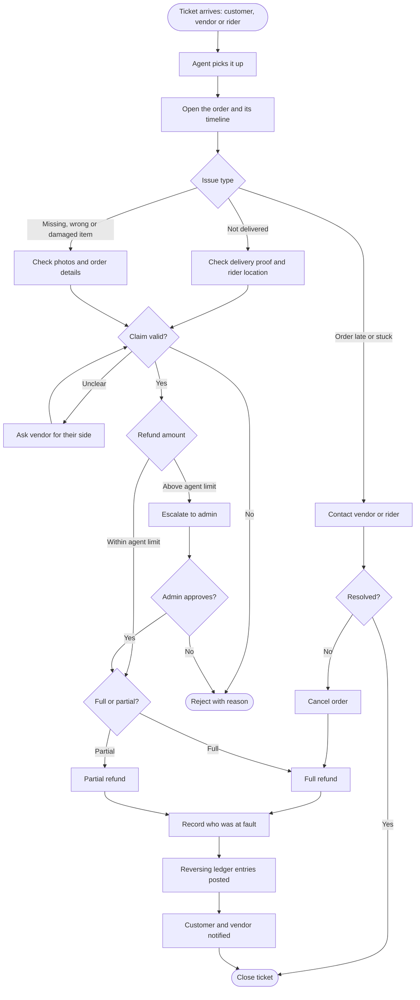

# Refunds and disputes

[Docs](../../README.md) / [Flows](../README.md) / [Support](README.md) / Refunds and disputes

## Flow

## Actions

| Screen | Element | Agent does | What happens | Leads to |
|---|---|---|---|---|
| Tickets | Tabs: Unassigned, Mine, Waiting, Closed | Switches | Filters tickets; Unassigned is sorted oldest first | Stays |
| Tickets | **Take** | Clicks | Ticket is assigned to this agent | Ticket detail |
| Ticket detail | Customer's message and photos | Views | Photos open through short-lived private links | Stays |
| Ticket detail | **View order** | Clicks | Opens the order with items, payment, timeline and delivery proof | Order panel |
| Order lookup | Search by order ID or phone | Types | Finds an order when the customer calls without a ticket | Order panel |
| Order panel | **Contact vendor / rider / customer** | Clicks | Shows the number; the view is logged | Stays |
| Ticket detail | **Ask vendor** | Types a question | The vendor gets it in their dashboard and has 24 hours to answer | Ticket status Waiting |
| Ticket detail | **Refund** | Ticks items or enters an amount | The amount is compared with the agent's limit | Refund form |
| Refund form | Fault: vendor, rider, platform | Selects | Decides whose balance bears the cost | Stays |
| Refund form | **Issue refund** (within limit) | Clicks | Refund goes to the gateway; ledger entries are posted; customer and vendor are notified | Ticket detail |
| Refund form | **Escalate** (above limit) | Clicks with a note | Ticket moves to the admin's refund approvals | Ticket status Escalated |
| Ticket detail | **Reject** + reason | Clicks, selects | Customer sees the reason and can reply once to appeal | Ticket closed |
| Ticket detail | **Issue coupon** | Enters value | A goodwill coupon is added to the customer's account | Ticket detail |
| Ticket detail | **Close** | Clicks | Ticket closes; the customer is asked to rate the support | Tickets |

## Who bears the cost

| Fault | Customer | Vendor | Platform |
|---|---|---|---|
| Vendor (wrong or missing item) | Refunded | Earning for those items reversed | Commission for those items reversed |
| Rider (damaged or not delivered) | Refunded | Still paid | Bears the refund; may recover from rider |
| Platform (system error) | Refunded | Still paid | Bears the refund |

## Rules and edge cases

- **Agent limit:** set by the admin in platform settings; anything above goes to an admin.
- **Refund window:** 48 hours from delivery; later claims need admin approval.
- **Vendor disputes a refund:** the vendor can contest within 7 days; an admin makes the final decision and may reverse the deduction.
- **First response target:** 15 minutes for an order still in progress, 4 hours for a delivered order.
- **What an agent cannot do:** change commissions, plans, payouts or settings, or view vendor bank details.

## Related

- [Customer: reviews and refunds](../customer/reviews-and-refunds.md)
- [Admin: orders and refunds](../admin/orders-and-refunds.md)
- [System: money flow](../system/money-flow.md)
