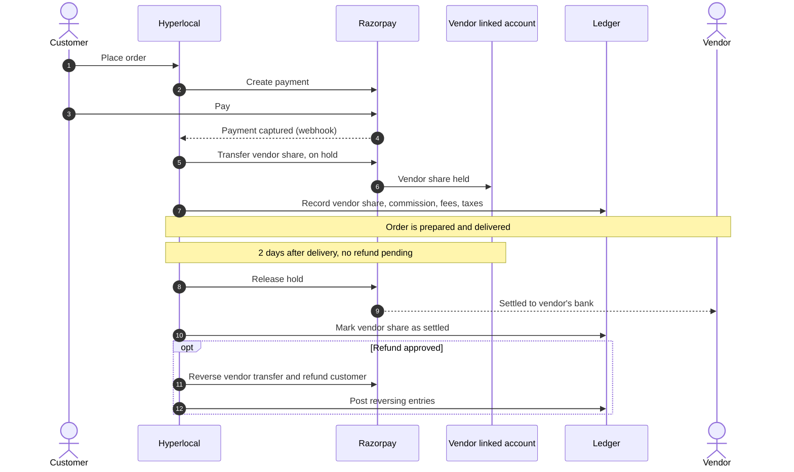

# Money flow

[Docs](../../README.md) / [Flows](../README.md) / [System](README.md) / Money flow

The platform never holds vendor money in its own bank account. Each vendor has a Razorpay
Route linked account; their share of each payment is transferred there on hold and released
two days after delivery. Details: [Monetization](../../product/monetization.md#money-flow).

The vendor's share is the order value minus commission, GST on commission, TCS and TDS.
The platform keeps commission, platform fees and any taxes it must file.
