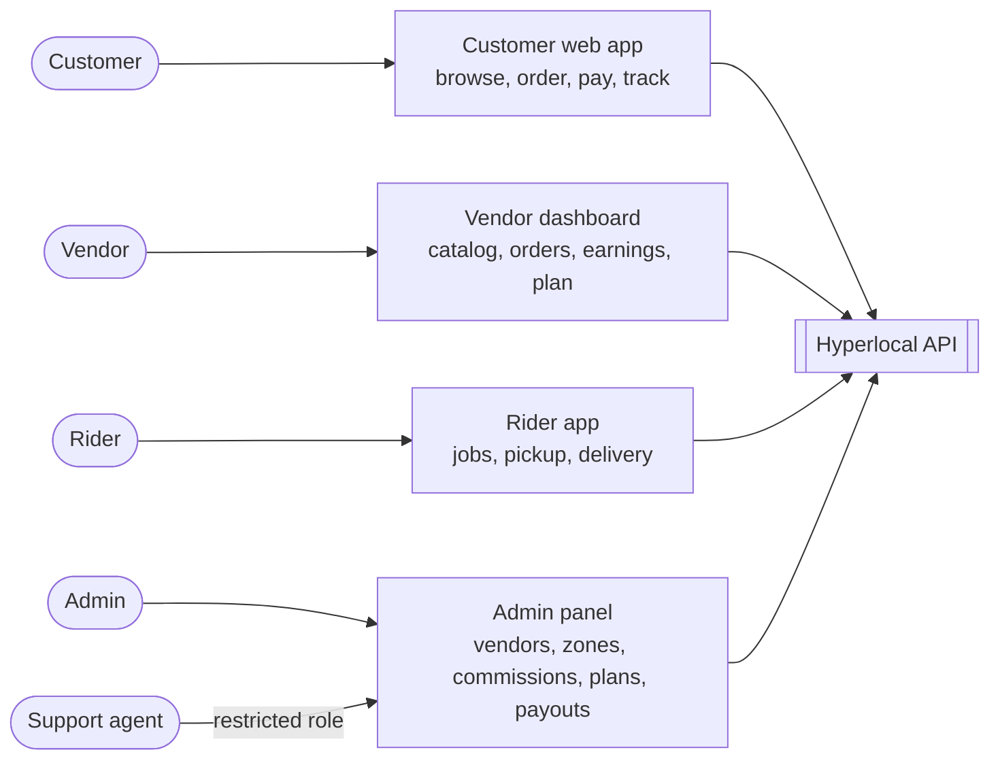

# Roles and apps

[Docs](../../README.md) / [Flows](../README.md) / [System](README.md) / Roles and apps

Five roles use four apps; the support agent works inside the admin panel with restricted permissions.

