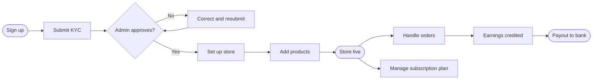

# Vendor flows

[Docs](../../README.md) / [Flows](../README.md) / Vendor

The vendor uses the vendor dashboard. This page shows the vendor's path from signup to
payout; each step links to a detailed file.

## Journey

## Detailed flows

| # | Flow | Screens covered |
|---|---|---|
| 1 | [Onboarding and verification](onboarding.md) | Signup, business details, KYC upload, plan choice, review status |
| 2 | [Store setup](store-setup.md) | Store profile, hours, delivery zones, open/close switch |
| 3 | [Products](products.md) | Product list, add/edit product, variants, stock, bulk import |
| 4 | [Orders](orders.md) | Incoming order alert, order detail, accept, prepare, hand over |
| 5 | [Earnings and payouts](earnings-and-payouts.md) | Wallet, transactions, payout history, bank account |
| 6 | [Subscription](subscription.md) | Current plan, upgrade, downgrade, invoices, cancel |
