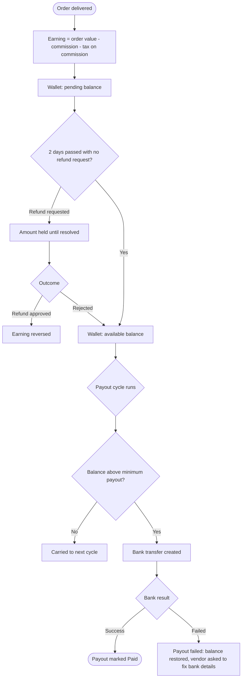

# Earnings and payouts

[Docs](../../README.md) / [Flows](../README.md) / [Vendor](README.md) / Earnings and payouts

How a vendor sees what they earned and how the money reaches their bank.

## Flow

## Actions

| Screen | Element | Vendor does | What happens | Leads to |
|---|---|---|---|---|
| Earnings | Summary cards: today, this week, pending, available | Views | Figures are computed from the ledger | Stays |
| Earnings | Date range picker | Selects | Cards, chart and transaction list reload for that range | Stays |
| Earnings | Transaction row | Taps | Shows the order's breakdown: item total, commission rate and amount, tax, net earning | Transaction detail |
| Transaction detail | **View order** | Taps | Opens the order | [Orders](orders.md) |
| Earnings | **Export** | Taps | A CSV of the range is generated and downloaded | Download |
| Payouts | Payout row | Taps | Lists the orders included, the amount, bank reference and date | Payout detail |
| Payouts | **Download statement** | Taps | PDF statement with the platform's commission invoice | Download |
| Bank account | **Change account** | Enters new details, confirms with OTP | The new account is validated; payouts pause for 24 hours as a fraud safeguard | Bank account |

## Rules and edge cases

- **Payout schedule:** automatic, on the admin-set cycle (default daily, for orders delivered at least 2 days earlier).
- **Minimum payout:** balances under the minimum roll over to the next cycle.
- **Negative balance:** refunds or COD commission can take the wallet below zero; the shortfall is recovered from later earnings before any payout.
- **Subscription fee:** charged to the vendor's saved payment method, not deducted from the wallet, unless the vendor opts in to wallet deduction.
- **Commission shown is the rate at order time,** including any plan discount active then.
- **Failed payout:** the amount returns to the available balance and is retried in the next cycle after the bank details are fixed.

## Related

- [System: money flow](../system/money-flow.md)
- [Admin: payouts](../admin/payouts.md)
- [Monetization](../../product/monetization.md)
