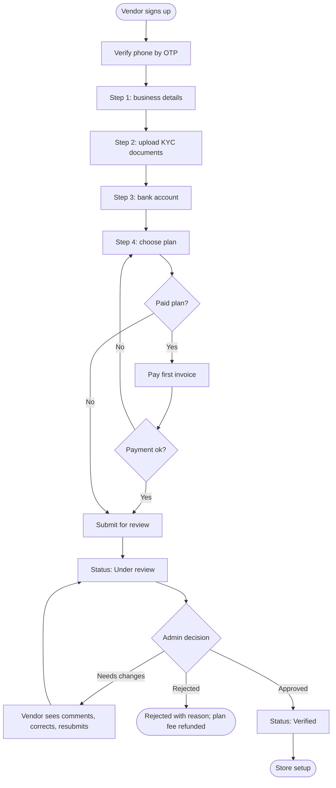

# Vendor onboarding and verification

[Docs](../../README.md) / [Flows](../README.md) / [Vendor](README.md) / Onboarding and verification

A vendor signs up themselves; the store cannot sell until an admin has verified the documents.

## Flow

## Actions

| Screen | Element | Vendor does | What happens | Leads to |
|---|---|---|---|---|
| Signup | Phone + **Get OTP** | Enters number | OTP sent; on verification a vendor account is created in Draft status | Step 1 |
| Step 1 | Business name, owner name, store category, address with map pin, **Next** | Fills, taps | Details are saved as a draft; the pin's zone is detected | Step 2 |
| Step 2 | Upload tiles: ID proof, business registration, GST number, food or drug licence where the category needs it | Picks files | Each file is checked (PDF/JPG/PNG, max 5 MB) and uploaded to private storage | Tile shows "Uploaded" |
| Step 2 | **Next** | Taps | Blocked until every document required for the chosen category is uploaded | Step 3 |
| Step 3 | Account holder, account number, IFSC, **Verify** | Fills, taps | The account is validated through the payment provider and linked for payouts | Step 4 |
| Step 4 | Plan cards | Selects one | Shows price, product limit, commission discount and featured slots | Stays |
| Step 4 | **Continue** | Taps | Free plan: goes straight to submit. Paid plan: payment sheet opens | Submit or payment |
| Review | **Submit for review** | Taps | Status becomes Under review; the application enters the admin's queue; the vendor gets a confirmation SMS and email | Status screen |
| Status screen | Admin comments (if changes requested) | Reads, taps **Edit** | Only the flagged steps are reopened | The flagged step |
| Status screen | **Resubmit** | Taps | Returns to the admin's queue | Status screen |
| Any step | **Save and exit** | Taps | Progress is kept; the vendor resumes at the same step on next login | Login |

## Rules and edge cases

- **Statuses:** Draft, Under review, Changes requested, Verified, Rejected, Suspended.
- **Required documents depend on category:** food needs a food licence; pharmacy needs a drug licence. The list per category is set by the admin.
- **Duplicate check:** a phone number, GST number or bank account already attached to another vendor flags the application for the admin.
- **Rejected with a paid plan:** the first invoice is refunded in full.
- **Review time:** applications untouched for 48 hours are highlighted in the admin queue.
- **Staff accounts:** after verification the owner can invite staff with a restricted role (orders only, or catalog only).

## Related

- Admin side: [Vendor approval](../admin/vendor-approval.md)
- Next step: [Store setup](store-setup.md)
