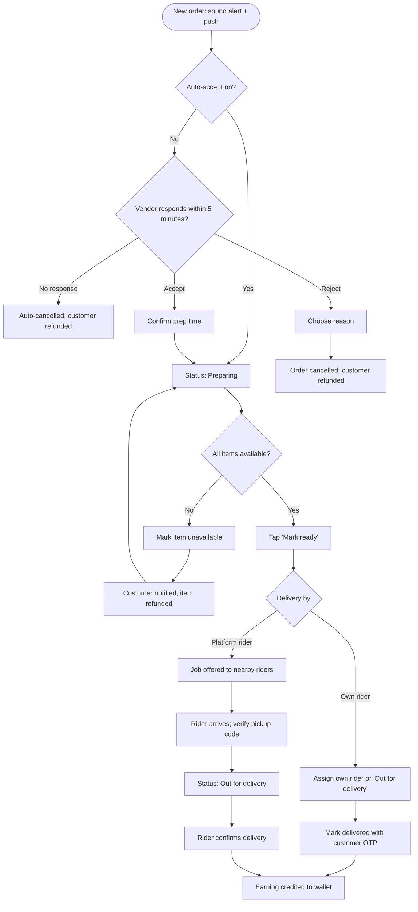

# Vendor orders

[Docs](../../README.md) / [Flows](../README.md) / [Vendor](README.md) / Orders

What the vendor does from the moment an order arrives until it leaves the store.

## Flow

## Actions

| Screen | Element | Vendor does | What happens | Leads to |
|---|---|---|---|---|
| Any screen | New-order alert with countdown | Taps | Opens the order; the alert keeps ringing until answered | Order detail |
| Order detail | **Accept** | Taps | Prep-time picker appears with the store default selected | Prep-time picker |
| Prep-time picker | Minutes + **Confirm** | Selects, taps | Status becomes Preparing; the customer sees the ETA; the countdown stops | Order detail |
| Order detail | **Reject** | Taps, picks a reason (item unavailable, too busy, closing) | Order is cancelled, stock released, customer notified and refunded. The rejection counts towards the store's acceptance rate | Orders list |
| Order detail | Item row **Unavailable** | Taps | That line is removed and refunded; the customer is notified. If it was the only item the order is cancelled | Order detail |
| Order detail | **Print** | Taps | Prints a kitchen/packing slip | Stays |
| Order detail | **Mark ready** | Taps | Status becomes Ready for pickup. From here the customer can no longer cancel. A delivery job is created | Order detail |
| Order detail (own riders) | **Out for delivery** | Taps | Status changes; the customer receives the delivery OTP | Order detail |
| Order detail (own riders) | **Mark delivered** + OTP field | Enters the customer's OTP | Status becomes Delivered and the earning is credited | Orders list |
| Order detail (platform riders) | Pickup code field | Enters the code shown on the rider's app | Confirms the right rider took the order; status becomes Out for delivery | Order detail |
| Order detail | **Call customer** | Taps | Dialer opens with a masked number | Dialer |
| Orders list | Tabs: New, Preparing, Ready, Completed, Cancelled | Switches | Filters orders | Stays |

## Rules and edge cases

- **Acceptance timer:** 5 minutes by default (admin-configurable). Timeout cancels the order and refunds the customer.
- **Vendor cancels after accepting:** allowed until pickup, with a reason; it is recorded and repeated cases are flagged to the admin.
- **No platform rider accepts:** after 10 minutes the vendor and support are alerted; support can reassign or cancel.
- **Cash on delivery with own rider:** the vendor has collected the cash, so the commission for that order is deducted from the wallet instead of credited.
- **Multi-store checkout:** the vendor sees only their own order and items, never the other stores' parts.
- **Store closed while orders are open:** existing orders must still be completed.

## Related

- [System: order lifecycle](../system/order-lifecycle.md)
- [Rider: jobs and delivery](../rider/jobs-and-delivery.md)
- [Earnings and payouts](earnings-and-payouts.md)
