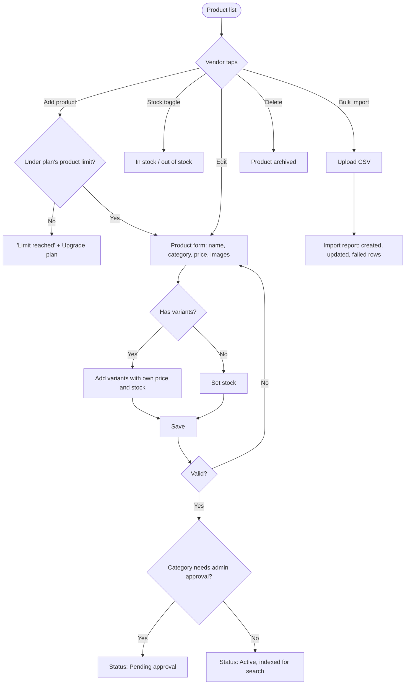

# Products

[Docs](../../README.md) / [Flows](../README.md) / [Vendor](README.md) / Products

Adding and maintaining the store's catalog.

## Flow

## Actions

| Screen | Element | Vendor does | What happens | Leads to |
|---|---|---|---|---|
| Product list | Search and category filter | Types or selects | List filters | Stays |
| Product list | **In stock** toggle on a row | Switches off | Product shows "Out of stock" to customers at once and cannot be added to carts | Stays |
| Product list | **Add product** | Taps | Product count is checked against the plan limit | Form, or upgrade prompt |
| Product form | Name, description | Types | | Stays |
| Product form | Category picker | Selects a leaf category | The commission rate for that category is shown so the vendor sees their earning per sale | Stays |
| Product form | Price, compare-at price | Enters | Compare-at price shows as a strike-through; it must be higher than the price | Stays |
| Product form | Images | Uploads up to 6 | Resized and stored; the first is the cover | Stays |
| Product form | **Add variant** | Taps | Adds a row: name (500 g, Large), price, stock, SKU | Stays |
| Product form | **Add-on group** | Taps | Adds optional extras with prices and a min/max choice count | Stays |
| Product form | Stock quantity or **Unlimited** | Enters | Unlimited suits made-to-order food; a number is decremented on each order | Stays |
| Product form | Veg / non-veg, tags | Selects | Used by customer filters | Stays |
| Product form | **Save** | Taps | Fields are validated; the product is saved and pushed to the search index | Product list |
| Product form | **Save as draft** | Taps | Saved but hidden from customers; does not count towards "Go live" | Product list |
| Product list | **Bulk import** | Uploads a CSV built from the template | Rows are processed in the background; each row creates or updates a product by SKU | Import report |
| Product list | **Delete** | Taps, confirms | Product is archived, not erased, so past orders still display it | Product list |

## Rules and edge cases

- **Plan limit:** counts active and pending products; archived and draft products do not count.
- **Downgrade below current count:** existing products stay, but no new one can be added until the count is under the new limit.
- **Price change:** applies to new carts only; orders already placed keep the price they were bought at.
- **Stock reaching zero:** the product switches to Out of stock automatically and the vendor is notified.
- **Low stock alert:** a notification at a threshold the vendor sets per product.
- **Category commission:** changing a product's category changes the commission on future orders only.

## Related

- [Subscription](subscription.md)
- [Admin: categories and commissions](../admin/categories-and-commissions.md)
