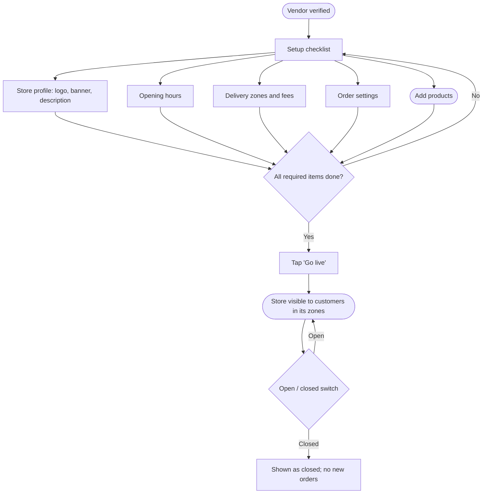

# Store setup

[Docs](../../README.md) / [Flows](../README.md) / [Vendor](README.md) / Store setup

After verification the vendor configures the store and switches it on. The same screens
are used later to change settings.

## Flow

## Actions

| Screen | Element | Vendor does | What happens | Leads to |
|---|---|---|---|---|
| Checklist | A checklist row | Taps | Opens that settings page; completed rows show a tick | That page |
| Store profile | Logo and banner upload | Picks an image | Image is resized and stored; preview updates | Stays |
| Store profile | Description, contact phone, **Save** | Edits, taps | Saved; changes show to customers immediately | Checklist |
| Opening hours | Day rows with open and close times | Sets times, can add a second slot per day | Saved per day | Stays |
| Opening hours | **Add holiday** | Picks a date | Store is closed on that date | Stays |
| Delivery zones | List of zones in the store's city | Ticks the zones it serves | Store appears to customers in those zones only | Stays |
| Delivery zones | Per zone: delivery fee, minimum order, prep time | Edits | Used to calculate fees and ETAs at checkout | Stays |
| Order settings | Auto-accept orders toggle | Switches on | New orders skip the accept step and go straight to Preparing | Stays |
| Order settings | Delivery by: own riders / platform riders | Selects | Decides who is offered the delivery job | Stays |
| Order settings | Cash on delivery toggle | Switches | COD is offered or hidden for this store | Stays |
| Checklist | **Go live** | Taps | Enabled only when profile, hours, one zone and one active product exist. Store status becomes Active and it is indexed for search | Dashboard |
| Dashboard header | **Open / Closed** switch | Switches | Closed: store shows as closed and cannot receive orders. Orders already accepted continue | Stays |

## Rules and edge cases

- **Automatic closing:** outside opening hours the store closes by itself; the switch is for closing early or pausing during a rush.
- **Zones available:** a store can only pick zones the admin has created in its city.
- **Platform riders:** selectable only after the rider app launches in the store's city (phase 2).
- **Too many missed orders:** three orders that time out in a row close the store automatically and alert the vendor.
- **Suspended by admin:** the switch is locked and a banner explains why.

## Related

- [Products](products.md)
- [Admin: delivery zones](../admin/zones.md)
