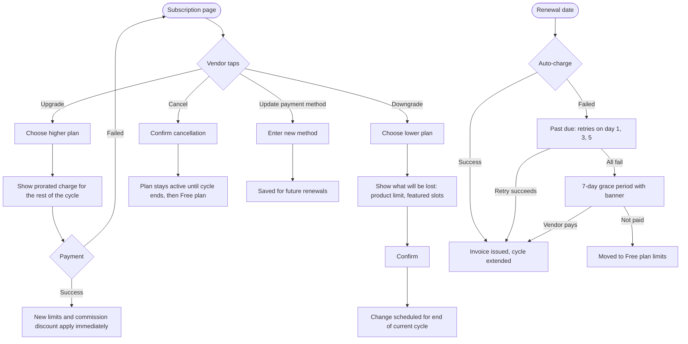

# Vendor subscription

[Docs](../../README.md) / [Flows](../README.md) / [Vendor](README.md) / Subscription

Viewing, upgrading, downgrading and cancelling the vendor's plan.

## Flow

## Actions

| Screen | Element | Vendor does | What happens | Leads to |
|---|---|---|---|---|
| Subscription | Current plan card | Views | Shows plan, price, renewal date, products used out of the limit, featured slots used | Stays |
| Subscription | **Compare plans** | Taps | Shows all plans side by side | Plan comparison |
| Plan comparison | **Upgrade** on a higher plan | Taps | Calculates the prorated amount for the remaining days | Payment sheet |
| Payment sheet | Pays | Completes payment | Plan changes at once; an invoice is issued; the new commission discount applies to orders placed from now | Subscription |
| Plan comparison | **Downgrade** on a lower plan | Taps | Warning lists what exceeds the lower plan (for example 320 products against a limit of 50) | Confirm dialog |
| Confirm dialog | **Confirm downgrade** | Taps | The change is scheduled for the renewal date; no refund for the current cycle | Subscription, showing "Changes on …" |
| Subscription | **Cancel scheduled change** | Taps | The scheduled downgrade or cancellation is removed | Subscription |
| Subscription | **Cancel plan** | Taps, confirms | Auto-renew is turned off; the plan runs to the end of the cycle, then becomes Free | Subscription |
| Subscription | **Update payment method** | Enters a new card or UPI mandate | Saved with the payment provider for renewals | Subscription |
| Subscription | Invoice row **Download** | Taps | PDF invoice with GST | Download |
| Past-due banner | **Pay now** | Taps | Charges the outstanding invoice | Subscription |

## Rules and edge cases

- **After a downgrade or expiry:** products above the new limit stay visible, but the vendor cannot add products until under the limit. Featured slots above the limit are removed, oldest first.
- **Commission discount:** always the discount of the plan active when the order was placed.
- **Renewal reminders:** 3 days before renewal and on each failed charge.
- **Plan price changed by admin:** existing subscribers keep their price until their next renewal and are notified in advance.
- **Plan retired by admin:** current subscribers stay on it; it cannot be newly selected.

## Related

- [System: subscription lifecycle](../system/subscription-lifecycle.md)
- [Admin: subscription plans](../admin/plans.md)
