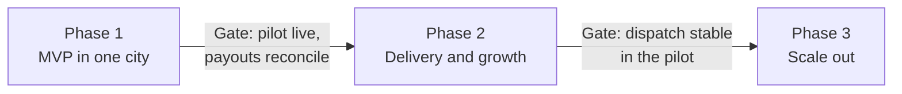

# Roadmap

[Docs](../README.md) / Product / Roadmap

Three phases. A phase starts only when the gate before it is met. No dates are set yet.

## Phase 1: MVP in one city

- Auth, roles, vendor onboarding and verification
- Catalog, delivery zones, featured home sections
- Search, multi-store cart and checkout, Buy now, payments
- Order lifecycle with live status and notifications
- Commission, ledger, payouts
- Vendor subscription plans
- Admin panel

Build order: repo and CI, auth and vendor onboarding, catalog and discovery, checkout and
orders, ledger and commissions, plans, then load tests and a security review before the pilot.

## Phase 2: delivery and growth

- Rider app; riders accept jobs themselves
- Live rider tracking
- Native customer app
- Coupons and featured listings
- Rider, store and item reviews; search filters
- Refund and dispute workflow

## Phase 3: scale out

- More cities and regions
- Dynamic delivery fees
- Service bookings
- Recommendations
- Loyalty wallet
- Vendor ads

Feature-level detail: [Features](features.md).
